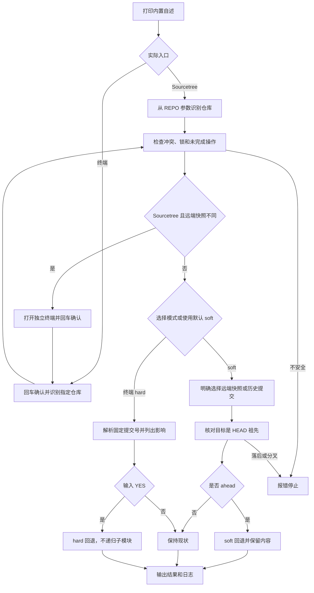

# `【MacOS@SourceTree】♻️双击Git（识别子Git） 提交回退.command`


<!-- jobs-toc:start -->
<!-- jobs-toc:source {"v":2,"token":"[toc]"} -->
<details>
<summary>📚 目录（点击展开 / 收起）</summary>

- [🔥 前言](#jobs-toc-heading-1)
- [一、功能与运行边界](#jobs-toc-heading-2)
- [二、运行方式](#jobs-toc-heading-3)
- [三、upstream 与 soft 的安全判据](#jobs-toc-heading-4)
- [四、执行流程](#jobs-toc-heading-5)
- [五、风险、日志与验证](#jobs-toc-heading-6)

</details>
<!-- jobs-toc:end -->

---

## <span id="jobs-toc-heading-1" data-jobs-toc="v2">🔥 <font id=前言>前言</font></span><!-- jobs-toc:heading-end -->

> 将选定目标之后的 [**Git**](https://git-scm.com/) 提交在本地撤回，保留索引和工作区供重新审阅。[**Sourcetree**](https://www.sourcetreeapp.com/) 自定义动作只允许 `soft`；各远端当前分支快照不同时，转交独立终端明确选择。破坏性的 `hard` 模式仅在直接终端运行并输入 `YES` 后执行。

## <span id="jobs-toc-heading-2" data-jobs-toc="v2">一、功能与运行边界 <a href="#前言" style="font-size:17px; color:green;"><b>🔼</b></a> <a href="#🔚" style="font-size:17px; color:green;"><b>🔽</b></a></span><!-- jobs-toc:heading-end -->

| 模式 | 目标 | 内容处理 |
| --- | --- | --- |
| soft 回退到 upstream | 默认 upstream，或明确选定的本地远端跟踪快照 | 移动当前分支，索引和工作区保留；待提交内容取决于实际净差异 |
| 选择提交 soft 回退 | 最近 200 条全分支提交记录中的 HEAD 祖先 | 保留所选提交，撤回其后的提交，索引和工作区保留 |
| hard 回退到 upstream | 默认或选定的远端跟踪快照 | 已跟踪的未提交内容被舍弃 |
| 选择提交 hard 回退 | 最近 200 条全分支提交记录 | 按完整提交号执行 hard 回退 |
| 选择 tag | 当前仓库标签 | 按 `refs/tags/<名称>` 解析后执行 hard 回退 |
| 选择 reflog | 最近 200 条本地 reflog 记录 | 按所选记录的完整提交号执行 hard 回退 |

- 终端选择依赖健康的 [**fzf**](https://github.com/junegunn/fzf)，缺失时停止并提示；不安装或升级软件，不写 Shell 配置。
- 普通仓库、嵌套独立仓库、使用 `.git` 指针文件的子模块和链接工作树均按传入路径定位最近的 Git 工作树。回退只作用于选定工作树，不向上回退父仓，不递归扫描或重置子模块内部文件。子仓 HEAD 改变可能使父仓显示 gitlink 漂移，父仓索引不会被自动暂存或提交。
- 确认后仅在脚本及子进程中隔离继承的 `GIT_DIR`、`GIT_WORK_TREE`、`GIT_COMMON_DIR`、`GIT_INDEX_FILE`、对象目录、前缀和 namespace 变量，避免它们覆盖传入仓库；不会修改启动它的终端或 Sourcetree 配置。
- 冲突、未完成的 merge / rebase / cherry-pick / revert / bisect、sequencer 或 `index.lock` 会阻止回退。
- 不提交、不推送、不执行 `clean`，不自动 Fetch。远端目标代表本地已有的跟踪快照，需要最新远端状态时应先在 Sourcetree Fetch 并核对。

## <span id="jobs-toc-heading-3" data-jobs-toc="v2">二、运行方式 <a href="#前言" style="font-size:17px; color:green;"><b>🔼</b></a> <a href="#🔚" style="font-size:17px; color:green;"><b>🔽</b></a></span><!-- jobs-toc:heading-end -->

Sourcetree 动作传入 `$REPO`，打印内置自述后检查当前分支的真实 upstream，以及各远端同名分支的本地快照。只有一条线路或快照相同时按默认 upstream 执行 `soft`；快照不同时打开独立 Terminal，由用户回车确认，再选择 soft 模式和目标，动作进程本身不等待输入。没有执行 reset 前会明确显示各线路快照，启动器成功仅代表终端已打开。缺少仓库路径直接失败，不猜测脚本所在仓库。

菜单属于仓库动作，仅传 `$REPO`，不会读取历史列表当前选中的提交。要指定某个历史节点，在终端选择“选择提交 soft 回退”；所选提交保留，只撤回它之后的提交。

终端在当前 README 所在目录执行：

```shell
'./【MacOS@SourceTree】♻️双击Git（识别子Git） 提交回退.command' '/path/to/repository'
```

要固定某条远端线路，可显式传入完整跟踪引用；引用必须已经存在，不接受 `~1`、`^` 等修订表达式，不会自动 Fetch：

```shell
'./【MacOS@SourceTree】♻️双击Git（识别子Git） 提交回退.command' '/path/to/repository' \
  --upstream refs/remotes/gitee/main
```

终端传入路径时仍先回车确认，再选择模式。不传路径时允许输入或拖入仓库目录；直接回车使用当前工作目录。按 `Ctrl+C` 可取消；fzf 回车选择，子层按 `←` 返回模式层，`Esc` 取消且不执行回退。Sourcetree 自动承接的终端使用内部首参数 `--terminal-soft`，仍要求真实交互输入，且只展示两种 soft 模式。

`hard` 模式先显示仓库完整路径、目标说明和提交号，然后要求输入完整 `YES`。回车或其它输入均取消。取消后没有重置动作。

## <span id="jobs-toc-heading-4" data-jobs-toc="v2">三、upstream 与 soft 的安全判据 <a href="#前言" style="font-size:17px; color:green;"><b>🔼</b></a> <a href="#🔚" style="font-size:17px; color:green;"><b>🔽</b></a></span><!-- jobs-toc:heading-end -->

1、显式 `--upstream` 优先；否则默认采用当前分支的真实 `@{upstream}`，支持远端名和分支名均不同于 `origin/当前分支` 的配置。终端存在多条当前分支快照时，显示完整引用和提交号供选择，不自动切换到最近失败的推送线路。

2、当前分支未配置远端时，才尝试已有的 `origin/当前分支` 跟踪引用。已有配置却缺少引用时停止，不切换到另一条线路。

3、游离 HEAD、指向本地分支的 upstream 或无有效提交的远端跟踪引用不适用远端回退。

4、`soft` 只允许 upstream 提交是当前 HEAD 的祖先。没有 ahead 提交时保持现状；本地落后或分叉时失败，先 Fetch 并检查历史后再处理。

5、保留已有暂存和工作区修改；回退后先核对 `git diff --cached` 与 `git diff`，确认下一次提交的实际内容。

6、多远端分别判断同步状态。例如 `HEAD=origin/main` 而 `gitee/main` 较旧时，按 origin 回退会保持现状；这不代表 Gitee 已同步。只有明确选定 gitee 的快照才以它为目标。某些被本地撤回的提交可能已进入其它远端，本脚本不改写任何远端引用。

7、撤回提交数不等于待提交文件数：空提交、先改后还原等情况可能没有净文件差异。脚本按实际索引报告“待提交差异”或“没有文件差异”。

8、仓库定位时保存实际工作树、Git 元数据目录、分支和 HEAD，执行前重新核对。选择期间切换分支、产生新提交、修改工作树绑定或出现未完成 Git 操作时停止；多远端列表中的提交号与选择完成后的引用也必须一致，避免静默使用变动后的目标。该检查不代替 Git 自身的引用锁。

9、hard 在展示目标前记录索引与已跟踪改动摘要，输入 `YES` 后重新比较；确认期间出现变化就停止，避免覆盖后来编辑的内容。摘要禁用索引自动刷新，不暂存内容或写入对象库；这不是内容备份，不能替代用户自行留存重要文件。

10、选择器仅对本次 fzf 调用清空 `FZF_DEFAULT_OPTS` 与 `FZF_DEFAULT_OPTS_FILE`，固定回车、返回与取消的输出契约，并确认返回项来自本次列表；用户全局 fzf 配置保持原样。

## <span id="jobs-toc-heading-5" data-jobs-toc="v2">四、执行流程 <a href="#前言" style="font-size:17px; color:green;"><b>🔼</b></a> <a href="#🔚" style="font-size:17px; color:green;"><b>🔽</b></a></span><!-- jobs-toc:heading-end -->



## <span id="jobs-toc-heading-6" data-jobs-toc="v2">五、风险、日志与验证 <a href="#前言" style="font-size:17px; color:green;"><b>🔼</b></a> <a href="#🔚" style="font-size:17px; color:green;"><b>🔽</b></a></span><!-- jobs-toc:heading-end -->

- `soft` 会移动当前分支 HEAD，原提交通常仍能通过 reflog 找到；它不是远端撤销动作。
- 从工作区删除超限文件、生成一次 revert 提交或只撤回空提交，都不代表超限 blob 已从待推送历史消失。应另行核对目标分支的完整可达历史，再决定大文件清理范围；本脚本不自动过滤历史或强推。
- `hard` 会覆盖工作区的已跟踪内容，也可能清除挡住目标已跟踪路径的未跟踪文件或目录。请先留存需要的内容；`YES` 只是执行门禁，不提供内容备份。
- 每次日志独立保存为系统临时目录中的 `【MacOS@SourceTree】♻️双击Git（识别子Git） 提交回退.年月日-时分秒.进程号.log`，含仓库、目标提交、执行结果和失败信息。首屏会显示本次完整日志位置；Sourcetree 启动器与承接终端各有自己的日志，不互相覆盖。
- Git 执行、输出过滤或日志写入失败时返回非零状态；Git 自身失败优先保留它的原始退出码，失败后不打印回退成功。
- 自动化验证使用隔离临时仓库，覆盖自定义 upstream、双远端与显式引用、嵌套独立仓库、子模块、链接工作树、索引 / 工作区及父仓保护、环境隔离、交互期间变化、无净变化、历史分叉与确认取消；脚本另做 `zsh -n`。菜单承接已在现有 Sourcetree 中核验，实际目标仍由运行者在终端明确选择。

<a id="🔚" href="#前言" style="font-size:17px; color:green; font-weight:bold;">我是有底线的➤点我回到首页</a>
