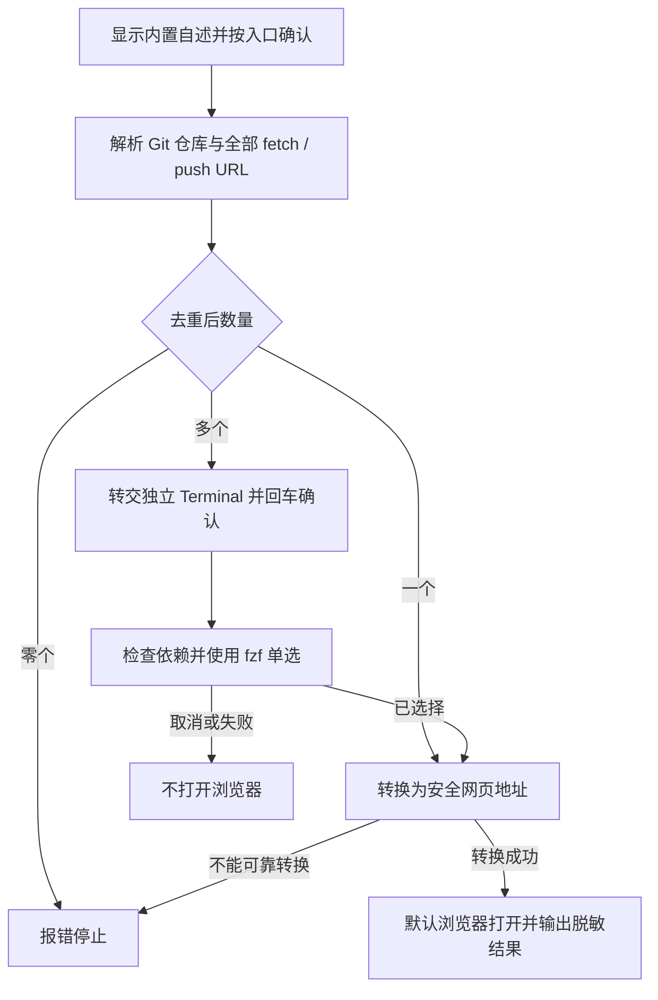

# `【MacOS@SourceTree】🌍打开远程仓库地址.command`


<!-- jobs-toc:start -->
<!-- jobs-toc:source {"v":2,"token":"[toc]"} -->
<details>
<summary>📚 目录（点击展开 / 收起）</summary>

- [🔥 前言](#%E5%89%8D%E8%A8%80)
- [一、使用方式与结果](#jobs-toc-heading-2)
- [二、候选地址与网页转换](#jobs-toc-heading-3)
- [三、依赖、影响范围与失败处理](#jobs-toc-heading-4)
- [四、执行流程与验证](#jobs-toc-heading-5)

</details>
<!-- jobs-toc:end -->

---

## 🔥 <span id="前言">前言</span>

从 [**Sourcetree**](https://www.sourcetreeapp.com/) 在默认浏览器打开当前 [**Git**](https://git-scm.com/) 仓库的远程网页。与 [🌐获取远程仓库地址](../【MacOS@SourceTree】🌐获取远程仓库地址.command/README.md) 共用地址收集、去重和选择逻辑；复制动作保留原始 URL，打开动作将选中值转换为可打开的网页地址。

## <span id="jobs-toc-heading-2" data-jobs-toc="v2">一、使用方式与结果 <a href="#前言" style="font-size:17px; color:green;"><b>🔼</b></a> <a href="#🔚" style="font-size:17px; color:green;"><b>🔽</b></a></span><!-- jobs-toc:heading-end -->

| 入口 / 条件 | 执行结果 |
| --- | --- |
| Sourcetree | 脚本参数填写 `$REPO`；动作进程只执行无需交互的步骤 |
| 唯一去重 URL | 直接打开系统默认浏览器，不要求 fzf |
| 多个 URL | 打开独立 Terminal，展示自述、回车继续，再使用 [**fzf**](https://github.com/junegunn/fzf) 单选 |
| fzf 按键 | 回车选择，`Esc` / `Ctrl+C` 取消；无匹配、空选或失败均不启动浏览器 |
| 没有远程地址 / 读取失败 | 报错停止 |
| 日志 | 系统临时目录中的 `【MacOS@SourceTree】🌍打开远程仓库地址.log` |

在本 README 所在目录执行：

```shell
/bin/zsh './【MacOS@SourceTree】🌍打开远程仓库地址.command' \
  '/path/to/repository'
```

可传第二个参数限定 remote；`REMOTE_NAME_OVERRIDE` 也可指定，第二参数优先。同一个 remote 有多个 URL 时仍需 fzf 选择。没有参数时在终端按内置说明输入路径，直接回车使用当前工作目录；非 Sourcetree 且无交互输入时停止。

## <span id="jobs-toc-heading-3" data-jobs-toc="v2">二、候选地址与网页转换 <a href="#前言" style="font-size:17px; color:green;"><b>🔼</b></a> <a href="#🔚" style="font-size:17px; color:green;"><b>🔽</b></a></span><!-- jobs-toc:heading-end -->

读取每个 remote 的全部 fetch / push URL，按完整原始地址去重并合并来源；不优先 origin，不把同一 remote 的多个 URL 截成首项。不同协议地址保留为不同候选，Git 生效的 URL 重写由 Git 自身解析。

| 选中地址 | 网页结果 / 边界 |
| --- | --- |
| `https://host/group/repo.git` | `https://host/group/repo` |
| `http://host:8080/group/repo.git` | 保留 HTTP 与显式网页端口，移除尾部 `.git` |
| `git@host:group/repo.git` | `https://host/group/repo` |
| `ssh://git@host/group/repo.git`、SSH 端口 22 | `https://host/group/repo` |
| `git://host/group/repo.git` | 使用对应 HTTPS 主机和路径；Git 传输专用端口不能视为网页端口 |
| SSH 非 22 端口或其它不明端口映射 | 停止，提示配置明确的 HTTPS 远程地址 |
| 本地路径、`file://`、危险或未知协议、畸形地址 | 拒绝打开 |

HTTP 用户信息、查询参数与片段不会传给浏览器；选择列表和日志使用脱敏展示值。转换只做本地解析，不验证该主机是否真的提供对应网页。自建主机、SSH 别名与托管服务的特殊网页路由仍以实际 HTTPS 远程地址为准，不能通过猜测端口或替换主机证明可访问。

## <span id="jobs-toc-heading-4" data-jobs-toc="v2">三、依赖、影响范围与失败处理 <a href="#前言" style="font-size:17px; color:green;"><b>🔼</b></a> <a href="#🔚" style="font-size:17px; color:green;"><b>🔽</b></a></span><!-- jobs-toc:heading-end -->

基础需要健康 Git 和 macOS 系统 `open`；多地址选择另需 Terminal / AppleScript 与 fzf。`fzf → Homebrew → bash / curl / Git / Command Line Tools` 的发现、安装与复检规则与 [获取动作依赖链](../【MacOS@SourceTree】🌐获取远程仓库地址.command/README.md#selector-dependencies) 一致：健康工具复用，缺失或损坏在终端直接回车同意安装 / 修复、任意非空输入取消。Homebrew 缺失时明确选择系统 / 用户位置，不改 Shell 启动配置；缺 CLT 打开系统安装流程后停止。每层修复一次后立即复检，失败不启动浏览器。

脚本只读取本地 Git 配置、写日志和打开选中网页；用户确认的依赖安装会写软件前缀。不执行 fetch、pull、push、commit，不修改 Git 配置、索引或业务文件，不覆盖剪贴板。浏览器与依赖下载会联网；系统启动命令失败返回非零状态，成功只说明系统接受打开请求，不能等同网页可访问。

## <span id="jobs-toc-heading-5" data-jobs-toc="v2">四、执行流程与验证 <a href="#前言" style="font-size:17px; color:green;"><b>🔼</b></a> <a href="#🔚" style="font-size:17px; color:green;"><b>🔽</b></a></span><!-- jobs-toc:heading-end -->



语法与行为验证使用临时 Git 仓库、受控浏览器命令及选择器，覆盖候选去重、网页转换和取消 / 失败无打开，运行入口见 [测试说明](../Tests/README.md)。真实托管网页可达性、浏览器登录与 Windows 实机不由 macOS 隔离验证保证。

<a id="🔚" href="#前言" style="font-size:17px; color:green; font-weight:bold;">我是有底线的➤点我回到首页</a>
