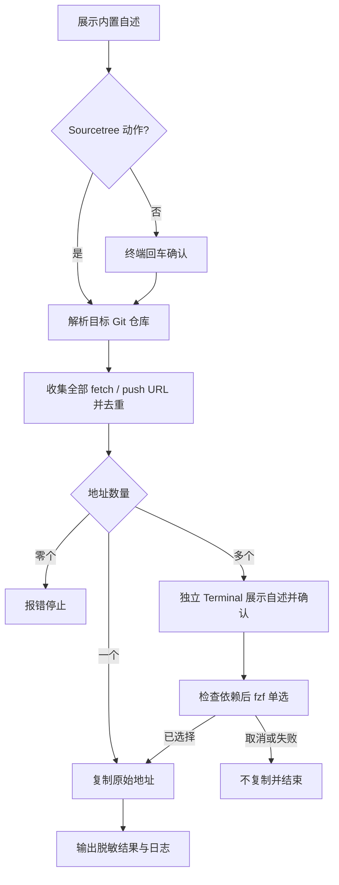

# `【MacOS@SourceTree】🌐获取远程仓库地址.command`


<!-- jobs-toc:start -->
<!-- jobs-toc:source {"v":2,"token":"[toc]"} -->
<details>
<summary>📚 目录（点击展开 / 收起）</summary>

- [🔥 前言](#jobs-toc-heading-1)
- [一、脚本用途](#jobs-toc-heading-2)
- [二、运行方式](#jobs-toc-heading-3)
  - [2.1、Sourcetree 自定义动作](#jobs-toc-heading-4)
  - [2.2、终端独立运行](#jobs-toc-heading-5)
- [三、远程选择规则](#jobs-toc-heading-6)
  - [3.1、选择器依赖链](#selector-dependencies)
- [四、安全与隐私](#jobs-toc-heading-8)
- [五、流程图](#jobs-toc-heading-9)

</details>
<!-- jobs-toc:end -->

---

## <span id="jobs-toc-heading-1" data-jobs-toc="v2">🔥 <font id=前言>前言</font></span><!-- jobs-toc:heading-end -->

- 本自述文件对应脚本：`./【MacOS@SourceTree】🌐获取远程仓库地址.command`。
- 脚本定位：用于 [**Sourcetree**](https://www.sourcetreeapp.com/) 自定义动作入口，获取当前 [**Git**](https://git-scm.com/) 仓库中选定的远程地址；[打开动作](../【MacOS@SourceTree】🌍打开远程仓库地址.command/README.md) 使用相同候选规则。
- 推荐参数：在 Sourcetree 自定义动作的参数栏填写 `$REPO`。
- 核心结果：脚本会在输出窗口打印远程名称和地址，并把原始远程地址复制到 macOS 剪贴板。
- 安全边界：不执行 fetch、pull、push、commit，不修改 Git 配置、索引或业务文件；依赖齐全时不联网，依赖安装经终端确认才联网。
- 依赖检查：实际执行 `git --version` 验证 Git；只有多个地址需要选择时才检查 [**fzf**](https://github.com/junegunn/fzf) 及所需选项，缺失或损坏时进入终端确认安装 / 修复分支，失败停止。
- 日志位置：系统临时目录中的 `【MacOS@SourceTree】🌐获取远程仓库地址.log`。

## <span id="jobs-toc-heading-2" data-jobs-toc="v2">一、脚本用途 <a href="#前言" style="font-size:17px; color:green;"><b>🔼</b></a> <a href="#🔚" style="font-size:17px; color:green;"><b>🔽</b></a></span><!-- jobs-toc:heading-end -->

| 项目 | 说明 |
|---|---|
| 脚本名称 | `【MacOS@SourceTree】🌐获取远程仓库地址.command` |
| 主要入口 | Sourcetree 自定义动作 |
| 推荐参数 | `$REPO` |
| 默认范围 | 全部 remote 的所有 fetch / push URL，完整地址去重；不优先 `origin` |
| 输出内容 | 仓库根目录、远程名称、远程仓库地址 |
| 剪贴板 | 自动复制 Git 配置中的原始远程地址 |
| 是否修改项目文件 | `否` |
| 是否修改 Git 状态 | `否` |
| 是否联网 | 不访问远程仓库；确认安装依赖时才联网 |

## <span id="jobs-toc-heading-3" data-jobs-toc="v2">二、运行方式 <a href="#前言" style="font-size:17px; color:green;"><b>🔼</b></a> <a href="#🔚" style="font-size:17px; color:green;"><b>🔽</b></a></span><!-- jobs-toc:heading-end -->

### <span id="jobs-toc-heading-4" data-jobs-toc="v2">2.1、Sourcetree 自定义动作 <a href="#前言" style="font-size:17px; color:green;"><b>🔼</b></a> <a href="#🔚" style="font-size:17px; color:green;"><b>🔽</b></a></span><!-- jobs-toc:heading-end -->

- 推荐配置如下：

  | 配置项 | 建议值 |
  |---|---|
  | 脚本 | `./【MacOS@SourceTree】🌐获取远程仓库地址.command` |
  | 参数 | `$REPO` |
  | 输出 | 建议开启完整输出，方便核对仓库和远程名称 |

- 运行后会得到两份结果：

  | 位置 | 内容 |
  |---|---|
  | 输出窗口 | 仓库根目录、远程名称、远程地址和日志位置 |
  | macOS 剪贴板 | Git 配置中的原始远程地址 |

### <span id="jobs-toc-heading-5" data-jobs-toc="v2">2.2、终端独立运行 <a href="#前言" style="font-size:17px; color:green;"><b>🔼</b></a> <a href="#🔚" style="font-size:17px; color:green;"><b>🔽</b></a></span><!-- jobs-toc:heading-end -->

- 进入脚本目录后执行：

  ```shell
  './【MacOS@SourceTree】🌐获取远程仓库地址.command' '/path/to/repository'
  ```

- 可以把远程名作为第二个参数，或使用 `REMOTE_NAME_OVERRIDE` 限定候选范围；该 remote 有多个 URL 时仍通过 fzf 选择：

  ```shell
  './【MacOS@SourceTree】🌐获取远程仓库地址.command' '/path/to/repository' 'upstream'
  ```

- 不传参数时，脚本会先展示内置自述并等待回车确认，再让你拖入或输入目标仓库路径；直接回车会使用当前工作目录。

## <span id="jobs-toc-heading-6" data-jobs-toc="v2">三、远程选择规则 <a href="#前言" style="font-size:17px; color:green;"><b>🔼</b></a> <a href="#🔚" style="font-size:17px; color:green;"><b>🔽</b></a></span><!-- jobs-toc:heading-end -->

| 条件 | 行为 |
| --- | --- |
| 指定第二参数 / `REMOTE_NAME_OVERRIDE` | 只收集该 remote 的全部 fetch / push URL；第二参数优先 |
| 未指定 remote | 收集所有 remote 的全部 fetch / push URL |
| 无地址或读取失败 | 明确报错，不复制、不猜测 |
| 完整 URL 去重后只有一个 | Sourcetree 中直接复制，不启动终端，也不要求 fzf |
| 去重后有多个 | Sourcetree 打开独立 Terminal；终端展示自述、回车继续，再用 fzf 单选 |

- 同一原始 URL 出现在多个 remote 或同时用于 fetch / push 时合并来源；协议或值不同的地址保留为不同候选。
- fzf 面板显示编号、remote / fetch / push 来源和脱敏 URL。回车选择，`Esc` / `Ctrl+C` 取消；没有匹配、空选、输入结束或选择器失败均不复制。
- SSH、HTTPS 等原始地址复制时保持原值，未做网页转换。
- 非 Sourcetree 且没有交互输入时停止。独立 Terminal 转交失败也停止，不在 Sourcetree 输出进程等待输入。

### 3.1、<span id="selector-dependencies">选择器依赖链</span> <a href="#前言" style="font-size:17px; color:green;"><b>🔼</b></a> <a href="#🔚" style="font-size:17px; color:green;"><b>🔽</b></a>

`fzf → Homebrew → bash / curl / Git / Command Line Tools`。先发现候选路径，再验证版本和所需选项；健康 fzf 直接复用，不更新 Homebrew。

缺失或损坏时在终端说明软件源和安装范围：直接回车同意安装 / 修复，任意非空输入取消。[**Homebrew**](https://brew.sh/) 可用时复用其实际前缀；缺失时检查上游工具，缺少 Command Line Tools 会打开系统安装流程并停止，安装完成后重新运行。Homebrew 引导先询问位置：精确输入 `YES` 使用系统目录，其它输入使用用户目录；只在当前进程激活，不改 Shell 启动配置。

fzf 采用一次 `brew install` 或 `brew reinstall`，随后刷新当前 PATH 并重新检查路径、版本和选项；任何一步失败都停止业务，保留日志及排查方向，不回退到数字菜单。

## <span id="jobs-toc-heading-8" data-jobs-toc="v2">四、安全与隐私 <a href="#前言" style="font-size:17px; color:green;"><b>🔼</b></a> <a href="#🔚" style="font-size:17px; color:green;"><b>🔽</b></a></span><!-- jobs-toc:heading-end -->

确认前只展示内置自述，不清空或写入旧日志；确认后才初始化本次日志。业务正文和路径按原文记录，反斜杠不会被解释为转义。

- 地址收集只读取本地 Git 配置，不执行 `fetch`、`pull`、`push`；已生效的 Git URL 重写由 Git 自身解析，不改配置。只有用户确认的依赖安装会联网。
- 脚本不会执行 `git add`、`git commit`、`git config`、`rm` 或 `sudo`。
- 选择列表、终端输出和日志对地址中的用户信息、查询参数和片段脱敏，业务仍使用未经展示替换的原始地址；日志不记录 fzf 原始敏感 URL。
- 剪贴板始终保留 Git 配置中的原始远程地址；粘贴到聊天、工单或公开文档前应确认其中不含凭据。
- `pbcopy` 缺失或写入失败时明确报错，不把仅显示地址当作复制成功。
- 验证采用临时 Git 仓库与受控剪贴板 / 浏览器命令，覆盖 URL 候选、去重、选择取消和失败传播；真实剪贴板、业务仓 Git 配置和远程内容不作为测试目标。运行入口见 [测试说明](../Tests/README.md)。

## <span id="jobs-toc-heading-9" data-jobs-toc="v2">五、流程图 <a href="#前言" style="font-size:17px; color:green;"><b>🔼</b></a> <a href="#🔚" style="font-size:17px; color:green;"><b>🔽</b></a></span><!-- jobs-toc:heading-end -->



<a id="🔚" href="#前言" style="font-size:17px; color:green; font-weight:bold;">我是有底线的➤点我回到首页</a>
