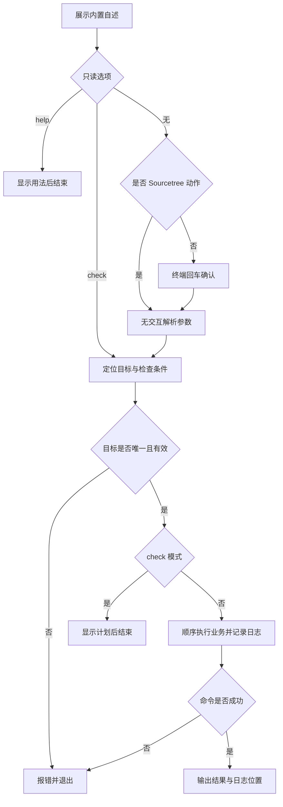

# `【MacOS@SourceTree】🐦Flutter自动化生产代码.command`


<!-- jobs-toc:start -->
<!-- jobs-toc:source {"v":2,"token":"[toc]"} -->
<details>
<summary>📚 目录（点击展开 / 收起）</summary>

- [🔥 前言](#jobs-toc-heading-1)
- [一、运行方式](#jobs-toc-heading-2)
- [二、执行前检查](#jobs-toc-heading-3)
- [三、实际执行流程](#jobs-toc-heading-4)
- [四、风险与失败处理](#jobs-toc-heading-5)
- [五、日志与产物](#jobs-toc-heading-6)
- [六、验证边界](#jobs-toc-heading-7)
- [七、流程图](#jobs-toc-heading-8)

</details>
<!-- jobs-toc:end -->

---

## <span id="jobs-toc-heading-1" data-jobs-toc="v2">🔥 <font id=前言>前言</font></span><!-- jobs-toc:heading-end -->

这是 [**Sourcetree**](https://www.sourcetreeapp.com/) 的 [**Flutter**](https://flutter.dev/) 工程动作。根据工程 `pubspec.yaml` 及目录约定，顺序生成所需代码和资源。

## <span id="jobs-toc-heading-2" data-jobs-toc="v2">一、运行方式 <a href="#前言" style="font-size:17px; color:green;"><b>🔼</b></a> <a href="#🔚" style="font-size:17px; color:green;"><b>🔽</b></a></span><!-- jobs-toc:heading-end -->

在 Sourcetree 已安装的动作中传入 `$REPO`。系统终端独立运行先打印脚本内置自述，按回车继续，按 `Ctrl+C` 取消；运行时不读取 README。Sourcetree 身份通过环境变量或父进程确认，非 TTY 本身不会绕过确认。

```shell
zsh "./【MacOS@SourceTree】🐦Flutter自动化生产代码.command" "<工程目录>"
```

接受 `[--check|--help] [工程路径]`；只接受一个可选工程路径。默认 `CLEAN_FIRST=0`、`DELETE_CONFLICTING_OUTPUTS=0`、`WATCH=0`，不主动 clean 或传入冲突删除标志。

```shell
zsh "./【MacOS@SourceTree】🐦Flutter自动化生产代码.command" \
  --check \
  "<工程目录>"
```

`CLEAN_FIRST=1` 先清理缓存，`DELETE_CONFLICTING_OUTPUTS=1` 允许 build_runner 处理冲突输出，两者只允许独立终端精确输入大写 `YES` 后运行。`WATCH=1` 在终端完成其他步骤后开启 build_runner watch；Sourcetree 跳过持续 watch。三个参数只接受 `0` 或 `1`。

`--help` 和 `--check` 均先显示内置自述，再直接完成只读流程，无须确认，不创建日志、不调用 SDK。普通入口在自述及确认阶段只输出屏幕；确认后才初始化日志。非 Sourcetree 且没有交互输入时直接退出。

## <span id="jobs-toc-heading-3" data-jobs-toc="v2">二、执行前检查 <a href="#前言" style="font-size:17px; color:green;"><b>🔼</b></a> <a href="#🔚" style="font-size:17px; color:green;"><b>🔽</b></a></span><!-- jobs-toc:heading-end -->

需要工程 Flutter / [**Dart**](https://dart.dev) SDK。使用 Protobuf 时还需要 `protoc` 与 `protoc-gen-dart`；不自动安装工具或增加项目依赖。

优先使用工程 `.fvm/flutter_sdk/bin/flutter`；声明 [**fvm**](https://fvm.app) 但本地固定 SDK 缺失时停止，人工完成 `fvm install / fvm use` 后重试。无固定 SDK 时使用当前 `PATH` 的真实 Flutter 路径，Dart 必须来自同一 SDK，不跨版本兜底。

路径支持中文、空格、字面引号、反斜杠和拖拽外层引号。工程必须声明 `dependencies.flutter.sdk: flutter`；支持常见块 / 单行 flow YAML、BOM / CRLF 和注释。递归定位排除依赖、缓存、构建及供应商目录；多个候选时直接指定目标。复杂或锚点依赖声明不猜测解析、不自动改写。

## <span id="jobs-toc-heading-4" data-jobs-toc="v2">三、实际执行流程 <a href="#前言" style="font-size:17px; color:green;"><b>🔼</b></a> <a href="#🔚" style="font-size:17px; color:green;"><b>🔽</b></a></span><!-- jobs-toc:heading-end -->

依赖只读取 `dependencies` / `dev_dependencies` 的直属包名；顶层配置键、注释或嵌套同名键不会伪装成依赖。任何命令失败立即停止并返回原始退出码。

| 生成器 | 启用条件 | 命令 |
| --- | --- | --- |
| build_runner | 直接声明依赖 | `dart run build_runner build` |
| App Icon | 依赖 + pubspec 顶层同名配置或 `flutter_launcher_icons.yaml` | `dart run flutter_launcher_icons` |
| 启动页 | 依赖 + pubspec 顶层同名配置或 `flutter_native_splash.yaml` | `dart run flutter_native_splash:create` |
| 国际化 | `flutter.generate: true` + `l10n.yaml` 或 `lib/l10n/*.arb` | `flutter gen-l10n` |
| FFI | ffigen 依赖 + pubspec 顶层配置或 `ffigen.yaml` | `dart run ffigen`，独立配置使用 `--config` |
| Pigeon | 依赖 + `pigeons/messages.dart` 中非注释 `@ConfigurePigeon` | 沿项目注解里的 Dart / 原生输出配置，不猜输出路径 |
| Protobuf | protobuf 依赖 + `protos/*.proto` + 两个可用工具 | 输出 `lib/generated`；声明 grpc 依赖才使用 gRPC 选项 |

缺少明确配置的生成器显示原因并跳过；启用 Protobuf 但缺少工具时在拉取依赖前停止。命令方式依据 [Dart build_runner 官方说明](https://dart.dev/tools/build_runner)、[flutter_launcher_icons](https://pub.dev/packages/flutter_launcher_icons)、[flutter_native_splash](https://pub.dev/packages/flutter_native_splash) 和 [Flutter 国际化说明](https://docs.flutter.dev/ui/internationalization)。

```shell
flutter pub get
dart run build_runner build
dart run flutter_launcher_icons
dart run flutter_native_splash:create
flutter gen-l10n
dart run ffigen
dart run pigeon --input pigeons/messages.dart
protoc --dart_out=lib/generated -Iprotos protos/*.proto
```

## <span id="jobs-toc-heading-5" data-jobs-toc="v2">四、风险与失败处理 <a href="#前言" style="font-size:17px; color:green;"><b>🔼</b></a> <a href="#🔚" style="font-size:17px; color:green;"><b>🔽</b></a></span><!-- jobs-toc:heading-end -->

只有检测到明确依赖与配置的生成器才执行。默认不主动传入 `--delete-conflicting-outputs`，但生成器仍会改写其管理的产物，执行前应保存修改；[build_runner 变更说明](https://pub.dev/packages/build_runner/changelog) 显示新版本自身也会处理被修改的生成输出，不能把缺少该标志视为文件保护承诺。

图标直接交给生成器维护，本脚本不提前删除图标。危险参数 `CLEAN_FIRST=1` / `DELETE_CONFLICTING_OUTPUTS=1` 需要终端精确 `YES`；Sourcetree 无交互模式直接停止。

Sourcetree 不发起输入等待；无法安全确定目标或缺少必要条件时直接报错。外部命令失败返回非零状态，后续业务停止。脚本及外部输出在受限输出窗口使用纯文本。

## <span id="jobs-toc-heading-6" data-jobs-toc="v2">五、日志与产物 <a href="#前言" style="font-size:17px; color:green;"><b>🔼</b></a> <a href="#🔚" style="font-size:17px; color:green;"><b>🔽</b></a></span><!-- jobs-toc:heading-end -->

执行日志位于系统临时目录，文件名为 `【MacOS@SourceTree】🐦Flutter自动化生产代码.log`。终端和 Sourcetree 都会打印实际日志位置。

## <span id="jobs-toc-heading-7" data-jobs-toc="v2">六、验证边界 <a href="#前言" style="font-size:17px; color:green;"><b>🔼</b></a> <a href="#🔚" style="font-size:17px; color:green;"><b>🔽</b></a></span><!-- jobs-toc:heading-end -->

两脚本合计通过 98 项隔离断言与 5 个 YAML 引号 / 锚点边界案例；覆盖只读零 SDK 调用 / 零日志、FVM 缺失停止、同 SDK Dart、精确依赖检测、生成器顺序、Pigeon 注解与输出、gRPC 条件、失败码保留、危险选项无交互拒绝及特殊路径。

已通过 `zsh -n` 静态语法检查。 入口已隔离验证非交互拒绝、确认前不创建日志、`NO_COLOR` 空值降级与业务失败退出码传播。隔离夹具验证没有运行真实 Flutter / Xcode 构建、安装、依赖清理或模拟器操作；真实工程的签名、网络和工具版本仍需按运行日志确认。

## <span id="jobs-toc-heading-8" data-jobs-toc="v2">七、流程图 <a href="#前言" style="font-size:17px; color:green;"><b>🔼</b></a> <a href="#🔚" style="font-size:17px; color:green;"><b>🔽</b></a></span><!-- jobs-toc:heading-end -->



<a id="🔚" href="#前言" style="font-size:17px; color:green; font-weight:bold;">我是有底线的➤点我回到首页</a>
