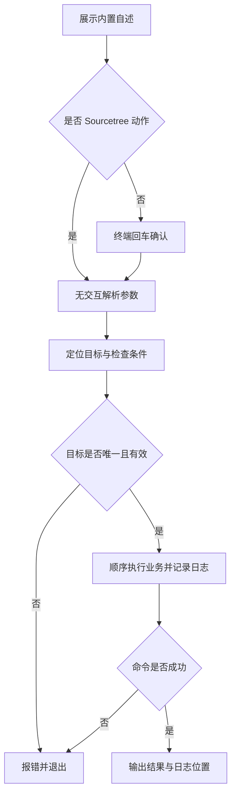

# `【MacOS@SourceTree】🐦Flutter重新拉取第三方依赖.command`


<!-- jobs-toc:start -->
<!-- jobs-toc:source {"v":2,"token":"[toc]"} -->
<details>
<summary>📚 目录（点击展开 / 收起）</summary>

- [🔥 前言](#jobs-toc-heading-1)
- [一、运行方式](#jobs-toc-heading-2)
- [二、执行前检查](#jobs-toc-heading-3)
- [三、实际执行流程](#jobs-toc-heading-4)
- [四、风险与失败处理](#jobs-toc-heading-5)
- [五、日志与产物](#jobs-toc-heading-6)
- [六、验证边界](#jobs-toc-heading-7)
- [七、流程图](#jobs-toc-heading-8)
  - [SDK获取前网络检测](#jobs-toc-heading-9)

</details>
<!-- jobs-toc:end -->

---

## <span id="jobs-toc-heading-1" data-jobs-toc="v2">🔥 <font id=前言>前言</font></span><!-- jobs-toc:heading-end -->

这是 [**Sourcetree**](https://www.sourcetreeapp.com/) 的 [**Flutter**](https://flutter.dev/) 工程动作。对选定工程顺序执行 `flutter clean` 与 `flutter pub get`，重新建立依赖解析和构建缓存。

## <span id="jobs-toc-heading-2" data-jobs-toc="v2">一、运行方式 <a href="#前言" style="font-size:17px; color:green;"><b>🔼</b></a> <a href="#🔚" style="font-size:17px; color:green;"><b>🔽</b></a></span><!-- jobs-toc:heading-end -->

在 Sourcetree 已安装的动作中传入 `$REPO`。系统终端独立运行先打印脚本内置自述，按回车继续，按 `Ctrl+C` 取消；运行时不读取 README。Sourcetree 身份通过环境变量或父进程确认，非 TTY 本身不会绕过确认。

```shell
zsh "./【MacOS@SourceTree】🐦Flutter重新拉取第三方依赖.command" "<工程目录>"
```

只接受一个可选工程路径。不传时使用 `PROJECT_DIR`、`REPO` 或当前目录。

自述与确认阶段只输出到屏幕；确认后才初始化日志。非 Sourcetree 且没有交互输入时直接退出，不执行工程业务。

## <span id="jobs-toc-heading-3" data-jobs-toc="v2">二、执行前检查 <a href="#前言" style="font-size:17px; color:green;"><b>🔼</b></a> <a href="#🔚" style="font-size:17px; color:green;"><b>🔽</b></a></span><!-- jobs-toc:heading-end -->

需要可调用的 Flutter SDK；存在 [**fvm**](https://fvm.app) 声明时只使用该工程明确版本、来源及缓存；缺失时用影子工程准备，不改 `.fvmrc`／旧配置、不回退全局Flutter。没有工程绑定时才复用或准备全局Flutter，Dart来自同一SDK。

路径支持中文、空格和拖拽外层引号。需要递归定位的工程动作会排除依赖、缓存和构建目录；多个工程候选时应直接指定目标。

## <span id="jobs-toc-heading-4" data-jobs-toc="v2">三、实际执行流程 <a href="#前言" style="font-size:17px; color:green;"><b>🔼</b></a> <a href="#🔚" style="font-size:17px; color:green;"><b>🔽</b></a></span><!-- jobs-toc:heading-end -->

任何一步失败都停止后续步骤，退出码传回 Sourcetree；标准输出和错误输出一起写入日志。

```shell
flutter clean
flutter pub get
```

## <span id="jobs-toc-heading-5" data-jobs-toc="v2">四、风险与失败处理 <a href="#前言" style="font-size:17px; color:green;"><b>🔼</b></a> <a href="#🔚" style="font-size:17px; color:green;"><b>🔽</b></a></span><!-- jobs-toc:heading-end -->

`flutter clean` 会清理构建产物和工具缓存；`pub get` 可能写入锁文件、生成依赖配置并联网。不会执行依赖版本升级、`pub cache repair` 或全局缓存删除。

健康SDK与工具直接复用；明确流程所需组件缺失或损坏时在终端内准备并复检，SourceTree动作本身不等待输入，必要准备转交独立Terminal并停止原进程。取消及失败保留原退出码，不继续工程业务。外部命令失败返回非零状态，后续业务停止。脚本及外部输出在受限输出窗口使用纯文本。

## <span id="jobs-toc-heading-6" data-jobs-toc="v2">五、日志与产物 <a href="#前言" style="font-size:17px; color:green;"><b>🔼</b></a> <a href="#🔚" style="font-size:17px; color:green;"><b>🔽</b></a></span><!-- jobs-toc:heading-end -->

执行日志位于系统临时目录，文件名为 `【MacOS@SourceTree】🐦Flutter重新拉取第三方依赖.log`。终端和 Sourcetree 都会打印实际日志位置。

## <span id="jobs-toc-heading-7" data-jobs-toc="v2">六、验证边界 <a href="#前言" style="font-size:17px; color:green;"><b>🔼</b></a> <a href="#🔚" style="font-size:17px; color:green;"><b>🔽</b></a></span><!-- jobs-toc:heading-end -->

已通过隔离假 SDK 验证路径含空格 / 中文、项目 FVM 优先级、clean 失败后不执行 pub get、非法路径和多工程候选拒绝。

已通过 `zsh -n` 静态语法检查。 入口已隔离验证非交互拒绝、确认前不创建日志、`NO_COLOR` 空值降级与业务失败退出码传播。隔离夹具验证没有运行真实 Flutter / Xcode 构建、安装、依赖清理或模拟器操作；真实工程的签名、网络和工具版本仍需按运行日志确认。

## <span id="jobs-toc-heading-8" data-jobs-toc="v2">七、流程图 <a href="#前言" style="font-size:17px; color:green;"><b>🔼</b></a> <a href="#🔚" style="font-size:17px; color:green;"><b>🔽</b></a></span><!-- jobs-toc:heading-end -->



[**Homebrew**](https://brew.sh/) 安装路径由用户选择：已有可运行安装时复用；确实需要安装时先强提示，只有精确输入大写 `YES` 才选择系统标准目录，其它输入或直接回车选择当前用户的 `.local/homebrew`。`YES` 只表示选择路径，权限与密码由官方安装器实际处理；有管理员权限也可以选用户目录。选定路径失败立即停止，不自动切换；`Ctrl+C` / 输入结束取消整个任务。

Sourcetree 缺少必要SDK或安装工具时转交独立Terminal，保留目标及原参数；只有该终端处理安装路径和后续确认。健康环境维持原动作模式。

**终端配色保护：** 独立运行时，在支持完整保存与恢复配色的交互终端中临时使用黑底白字及统一强调色；正常结束、失败或可捕获中断后恢复进入前的配色，不修改终端全局偏好或 Shell 启动配置。不支持完整保护、无交互终端、`NO_COLOR`、既有纯文本模式和 Sourcetree 场景不切换配色，并沿用纯文本输出约定。强制终止（如 `kill -9`）无法由脚本自身保证恢复，请使用运行时显示的独立恢复入口。

<a id="🔚" href="#前言" style="font-size:17px; color:green; font-weight:bold;">我是有底线的➤点我回到首页</a>


### <span id="jobs-toc-heading-9" data-jobs-toc="v2">SDK获取前网络检测</span><!-- jobs-toc:heading-end -->

原业务前先准备Flutter/Dart，平台打包前独立预缓存目标SDK；获取失败持续退避重试并重新检测来源与网络，Ctrl+C终止。显式源/代理包含空值保留，AUTO仅在获准公开等价制品及现有配置路线中选择；只注入当前SDK子进程，不写系统网络或Shell/Git配置。业务clean/pub/build保持原顺序且仅执行一次。
