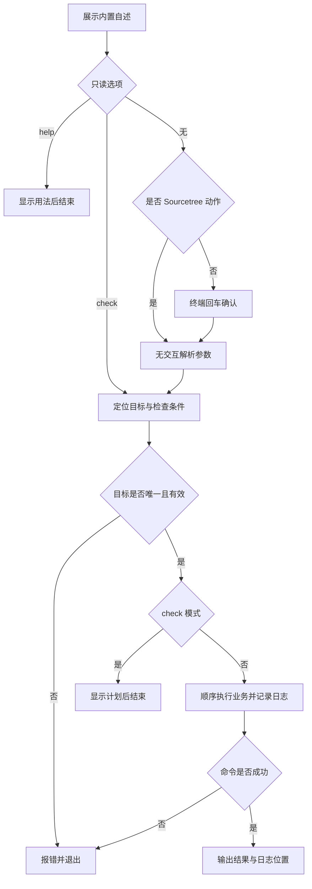

# `【MacOS@SourceTree】🐦Flutter项目体检.command`


<!-- jobs-toc:start -->
<!-- jobs-toc:source {"v":2,"token":"[toc]"} -->
<details>
<summary>📚 目录（点击展开 / 收起）</summary>

- [🔥 前言](#jobs-toc-heading-1)
- [一、运行方式](#jobs-toc-heading-2)
- [二、执行前检查](#jobs-toc-heading-3)
- [三、实际执行流程](#jobs-toc-heading-4)
- [四、风险与失败处理](#jobs-toc-heading-5)
- [五、日志与产物](#jobs-toc-heading-6)
- [六、验证边界](#jobs-toc-heading-7)
- [七、流程图](#jobs-toc-heading-8)

</details>
<!-- jobs-toc:end -->

---

## <span id="jobs-toc-heading-1" data-jobs-toc="v2">🔥 <font id=前言>前言</font></span><!-- jobs-toc:heading-end -->

这是 [**Sourcetree**](https://www.sourcetreeapp.com/) 的 [**Flutter**](https://flutter.dev/) 工程动作。默认检查 Flutter 工具链健康状态，也可明确选择仅拉取依赖或清理后拉取依赖。

## <span id="jobs-toc-heading-2" data-jobs-toc="v2">一、运行方式 <a href="#前言" style="font-size:17px; color:green;"><b>🔼</b></a> <a href="#🔚" style="font-size:17px; color:green;"><b>🔽</b></a></span><!-- jobs-toc:heading-end -->

在 Sourcetree 已安装的动作中传入 `$REPO`。系统终端独立运行先打印脚本内置自述，按回车继续，按 `Ctrl+C` 取消；运行时不读取 README。Sourcetree 身份通过环境变量或父进程确认，非 TTY 本身不会绕过确认。

```shell
zsh "./【MacOS@SourceTree】🐦Flutter项目体检.command" "<工程目录>"
```

参数为 `[--check|--help] [工程路径] [doctor|clean-get|pub-get]`，默认动作是 `doctor`。未知动作在操作工程前拒绝；路径中的引号、反斜杠、中文、空格和 `|` 保留原样。

| 入口 | 实际行为 | 工程写入 |
| --- | --- | --- |
| 默认 / `doctor` | `flutter doctor -v`；警告或错误返回非零 | 不主动改工程；SDK 自身可能准备缓存 |
| `--check` | 定位工程、SDK 并打印命令计划 | 不调用 SDK、不创建日志 |
| `pub-get` | `flutter pub get` | 依赖、锁定文件和工具状态 |
| `clean-get` | 终端精确输入 `YES` 后 clean，再 pub get | 清理缓存及生成目录，并写入依赖 |

```shell
zsh "./【MacOS@SourceTree】🐦Flutter项目体检.command" \
  --check \
  "<工程目录>"
```

`--help` 和 `--check` 均先显示内置自述，再直接完成只读流程，无须确认，不创建日志、不调用 SDK。普通入口在自述及确认阶段只输出屏幕；确认后才初始化日志。非 Sourcetree 且没有交互输入时直接退出。

## <span id="jobs-toc-heading-3" data-jobs-toc="v2">二、执行前检查 <a href="#前言" style="font-size:17px; color:green;"><b>🔼</b></a> <a href="#🔚" style="font-size:17px; color:green;"><b>🔽</b></a></span><!-- jobs-toc:heading-end -->

需要工程对应 Flutter SDK。工程需在 `pubspec.yaml` 的 `dependencies.flutter.sdk` 声明 `flutter`，支持常见块映射、单行 flow 映射、引号、注释和 UTF-8 BOM / CRLF；普通 Dart 包、嵌套伪声明和依赖声明中的 YAML 锚点不作为有效 Flutter 工程。

先使用工程 `.fvm/flutter_sdk/bin/flutter`；声明 [**fvm**](https://fvm.app) 但对应本地 SDK 缺失时停止，提示人工完成 `fvm install / fvm use`，不会回退全局版本或隐式安装。没有固定 SDK 时使用当前 `PATH` 的真实 Flutter 路径。不会安装或升级 [**Homebrew**](https://brew.sh/)，不会修改 shell 配置。

```shell
zsh "./【MacOS@SourceTree】🐦Flutter项目体检.command" "<工程目录>" doctor
zsh "./【MacOS@SourceTree】🐦Flutter项目体检.command" "<工程目录>" clean-get
```

## <span id="jobs-toc-heading-4" data-jobs-toc="v2">三、实际执行流程 <a href="#前言" style="font-size:17px; color:green;"><b>🔼</b></a> <a href="#🔚" style="font-size:17px; color:green;"><b>🔽</b></a></span><!-- jobs-toc:heading-end -->

选择 SDK 前先进入工程，避免读取启动目录的 FVM 配置；不使用脆弱的字符串分隔符传递目录和动作。

```shell
flutter doctor -v
# clean-get：flutter clean && flutter pub get
# pub-get：flutter pub get
```

## <span id="jobs-toc-heading-5" data-jobs-toc="v2">四、风险与失败处理 <a href="#前言" style="font-size:17px; color:green;"><b>🔼</b></a> <a href="#🔚" style="font-size:17px; color:green;"><b>🔽</b></a></span><!-- jobs-toc:heading-end -->

`doctor` 检查外部命令退出码及诊断报告：Flutter 命令即使返回 `0`，报告 `[!]`、`[✗]`、`[x]` 或 “Doctor found issues” 时仍返回 `1`，避免把命令执行完成误报为环境健康。原命令的非零退出码原样传递。

Flutter 自身可能准备 SDK 缓存；另外两个显式动作会写入工程依赖或清理构建目录。`clean-get` 只允许在可交互终端精确输入大写 `YES` 后运行；Sourcetree / 非交互入口直接停止。

Sourcetree 不发起输入等待；无法安全确定目标或缺少必要条件时直接报错。外部命令失败返回非零状态，后续业务停止。脚本及外部输出在受限输出窗口使用纯文本。

## <span id="jobs-toc-heading-6" data-jobs-toc="v2">五、日志与产物 <a href="#前言" style="font-size:17px; color:green;"><b>🔼</b></a> <a href="#🔚" style="font-size:17px; color:green;"><b>🔽</b></a></span><!-- jobs-toc:heading-end -->

执行日志位于系统临时目录，文件名为 `【MacOS@SourceTree】🐦Flutter项目体检.log`。终端和 Sourcetree 都会打印实际日志位置。

## <span id="jobs-toc-heading-7" data-jobs-toc="v2">六、验证边界 <a href="#前言" style="font-size:17px; color:green;"><b>🔼</b></a> <a href="#🔚" style="font-size:17px; color:green;"><b>🔽</b></a></span><!-- jobs-toc:heading-end -->

已用隔离假 SDK 验证默认诊断、显式依赖动作、clean-get 无交互拒绝、诊断有问题但命令返回 0、原始失败码传播、引号 / 反斜杠 / 空格 / 中文 / 竖线路径，以及块 / flow YAML、BOM / CRLF、注释、伪声明和锚点边界。

已通过 `zsh -n` 静态语法检查。 入口已隔离验证非交互拒绝、确认前不创建日志、`NO_COLOR` 空值降级与业务失败退出码传播。隔离夹具验证没有运行真实 Flutter / Xcode 构建、安装、依赖清理或模拟器操作；真实工程的签名、网络和工具版本仍需按运行日志确认。

## <span id="jobs-toc-heading-8" data-jobs-toc="v2">七、流程图 <a href="#前言" style="font-size:17px; color:green;"><b>🔼</b></a> <a href="#🔚" style="font-size:17px; color:green;"><b>🔽</b></a></span><!-- jobs-toc:heading-end -->



<a id="🔚" href="#前言" style="font-size:17px; color:green; font-weight:bold;">我是有底线的➤点我回到首页</a>
