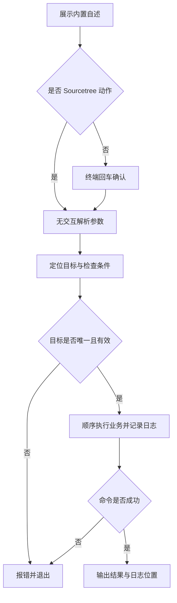

# `【MacOS@SourceTree】🐦打开：运行Flutter项目.command`


<!-- jobs-toc:start -->
<!-- jobs-toc:source {"v":2,"token":"[toc]"} -->
<details>
<summary>📚 目录（点击展开 / 收起）</summary>

- [🔥 前言](#jobs-toc-heading-1)
- [一、运行方式](#jobs-toc-heading-2)
- [二、执行前检查](#jobs-toc-heading-3)
- [三、实际执行流程](#jobs-toc-heading-4)
- [四、风险与失败处理](#jobs-toc-heading-5)
- [五、日志与产物](#jobs-toc-heading-6)
- [六、验证边界](#jobs-toc-heading-7)
- [七、流程图](#jobs-toc-heading-8)

</details>
<!-- jobs-toc:end -->

---

## <span id="jobs-toc-heading-1" data-jobs-toc="v2">🔥 <font id=前言>前言</font></span><!-- jobs-toc:heading-end -->

这是 [**Sourcetree**](https://www.sourcetreeapp.com/) 的 [**Flutter**](https://flutter.dev/) 工程动作。定位工程并把 `setup.command` 或标准 Flutter 运行流程交给系统 Terminal。

## <span id="jobs-toc-heading-2" data-jobs-toc="v2">一、运行方式 <a href="#前言" style="font-size:17px; color:green;"><b>🔼</b></a> <a href="#🔚" style="font-size:17px; color:green;"><b>🔽</b></a></span><!-- jobs-toc:heading-end -->

在 Sourcetree 已安装的动作中传入 `$REPO`。系统终端独立运行先打印脚本内置自述，按回车继续，按 `Ctrl+C` 取消；运行时不读取 README。Sourcetree 身份通过环境变量或父进程确认，非 TTY 本身不会绕过确认。

```shell
zsh "./【MacOS@SourceTree】🐦打开：运行Flutter项目.command" "<工程目录>"
```

接受工程目录、`pubspec.yaml` 或工程内文件。`JOBS_SOURCETREE_SETUP_DRY_RUN=1` 只输出 Terminal 命令，不补执行权限、不打开终端、不查询或启动设备。标准回退需要完整携带本动作目录中的 [Scripts](./Scripts/README.md)，按脚本自身位置定位，不依赖原电脑仓库路径。

自述与确认阶段只输出到屏幕；确认后才初始化日志。非 Sourcetree 且没有交互输入时直接退出，不执行工程业务。

## <span id="jobs-toc-heading-3" data-jobs-toc="v2">二、执行前检查 <a href="#前言" style="font-size:17px; color:green;"><b>🔼</b></a> <a href="#🔚" style="font-size:17px; color:green;"><b>🔽</b></a></span><!-- jobs-toc:heading-end -->

使用 [**macOS**](https://www.apple.com/macos/) 的 `osascript` 与 Terminal。标准回退沿用工程 [**FVM**](https://fvm.app/) SDK 或终端 Flutter；iOS 需要 [**Xcode**](https://developer.apple.com/xcode/) / `xcrun`，Android 需要 [**Android SDK**](https://developer.android.com/tools) 的 `emulator`、`adb`，创建时还需要 `avdmanager`、可运行的 Java，下载系统镜像时需要 `sdkmanager`。已有健康工具直接复用；SDK 或 Command-line Tools 缺失时停止并提示先使用“初始化 Android 模拟器”或 Android Studio 准备工具链，运行入口不自动安装完整 SDK、不升级全局 Flutter / Xcode。

路径支持中文、空格和拖拽外层引号。需要递归定位的工程动作会排除依赖、缓存和构建目录；多个工程候选时应直接指定目标。

## <span id="jobs-toc-heading-4" data-jobs-toc="v2">三、实际执行流程 <a href="#前言" style="font-size:17px; color:green;"><b>🔼</b></a> <a href="#🔚" style="font-size:17px; color:green;"><b>🔽</b></a></span><!-- jobs-toc:heading-end -->

显式无效路径不会回退到其它当前工程。先查找工程根目录、`tool/setup/`，再检查递归唯一的 `setup.command`；多个候选停止。找到时仍由工程脚本负责运行。没有时验证 Flutter 根目录，再转交同包 `Scripts/RunFlutterProject.zsh`，在 Terminal 中先展示运行器自述并回车确认，然后选择设备。

| 选择 | 实际行为 |
| --- | --- |
| 已连接设备 | 选择 Flutter 已识别且支持本工程的设备。 |
| iOS 模拟器 | 选择已有模拟器；缺失时选择型号、运行时、唯一名称，确认创建后启动。 |
| Android 模拟器 | 选择已有 AVD；缺失时选择型号、兼容系统镜像，确认所需下载与创建后启动。已有 AVD 不覆盖。 |
| 重新加载 | 重新读取 Flutter 设备列表。 |

Android 启动后按 AVD 名定位对应 `adb` 设备，等待系统完成启动及 Flutter 识别；失败或超时停止，不误用另一台模拟器。设备列表优先用 [**fzf**](https://github.com/junegunn/fzf) 上下键和关键字筛选；各层取消不会创建或下载。创建流程的子层可按 `←` 返回上一层，面板显示实际按键提示。

```shell
# 标准回退：入口按自身位置构造同包运行器路径，传入完整工程路径
/bin/zsh ./Scripts/RunFlutterProject.zsh --project "<Flutter 工程目录>"
```

Flutter 由当前登录会话的 `launchd` 托管；终端中输入 `r` 热重载、`R` 热重启、`d` 离开日志、`s` 停止并回车。关闭终端或 `Ctrl+C` 只离开日志，后台任务继续；再次运行并选择同一设备可重看日志。

## <span id="jobs-toc-heading-5" data-jobs-toc="v2">四、风险与失败处理 <a href="#前言" style="font-size:17px; color:green;"><b>🔼</b></a> <a href="#🔚" style="font-size:17px; color:green;"><b>🔽</b></a></span><!-- jobs-toc:heading-end -->

找到 setup.command 后尝试补齐该文件执行权限，并将运行交给 Terminal；后续行为由工程 setup.command 决定。Sourcetree 这里只报告交接完成，不能证明 App 已成功运行。

Sourcetree 动作窗口不发起输入等待；型号、镜像和执行确认在独立 Terminal 中完成。无法安全确定目标或缺少必要条件时直接报错。下载使用 Android 官方 SDK 软件源，执行前显示所选包及目标 SDK；拒绝下载或创建不会继续启动。脚本及外部输出在受限输出窗口使用纯文本。

## <span id="jobs-toc-heading-6" data-jobs-toc="v2">五、日志与产物 <a href="#前言" style="font-size:17px; color:green;"><b>🔼</b></a> <a href="#🔚" style="font-size:17px; color:green;"><b>🔽</b></a></span><!-- jobs-toc:heading-end -->

动作交接日志位于系统临时目录，文件名为 `【MacOS@SourceTree】🐦打开：运行Flutter项目.log`。标准运行器另打印操作日志路径，持久会话与完整运行日志位于当前用户资源库的 `Application Support/JobsFlutterRunner/sessions`；Android 模拟器日志独立保留。

## <span id="jobs-toc-heading-7" data-jobs-toc="v2">六、验证边界 <a href="#前言" style="font-size:17px; color:green;"><b>🔼</b></a> <a href="#🔚" style="font-size:17px; color:green;"><b>🔽</b></a></span><!-- jobs-toc:heading-end -->

[隔离测试](../Tests/FlutterRunDispatch.Tests.rb) 验证 dry-run、同包资源缺失时停止、`setup.command` 优先、工程与动作目录包含空格 / 引号 / Shell 字面量、完整目录复制改名及从无关工作目录调用。运行器的模拟器查询、选择、创建与就绪等待通过命令替身验证；未真实下载 Android SDK、创建或启动模拟器。

已通过 `zsh -n` 静态语法检查。 入口已隔离验证非交互拒绝、确认前不创建日志、`NO_COLOR` 空值降级与业务失败退出码传播。隔离夹具验证没有运行真实 Flutter / Xcode 构建、安装、依赖清理或模拟器操作；真实工程的签名、网络和工具版本仍需按运行日志确认。

## <span id="jobs-toc-heading-8" data-jobs-toc="v2">七、流程图 <a href="#前言" style="font-size:17px; color:green;"><b>🔼</b></a> <a href="#🔚" style="font-size:17px; color:green;"><b>🔽</b></a></span><!-- jobs-toc:heading-end -->



<a id="🔚" href="#前言" style="font-size:17px; color:green; font-weight:bold;">我是有底线的➤点我回到首页</a>
