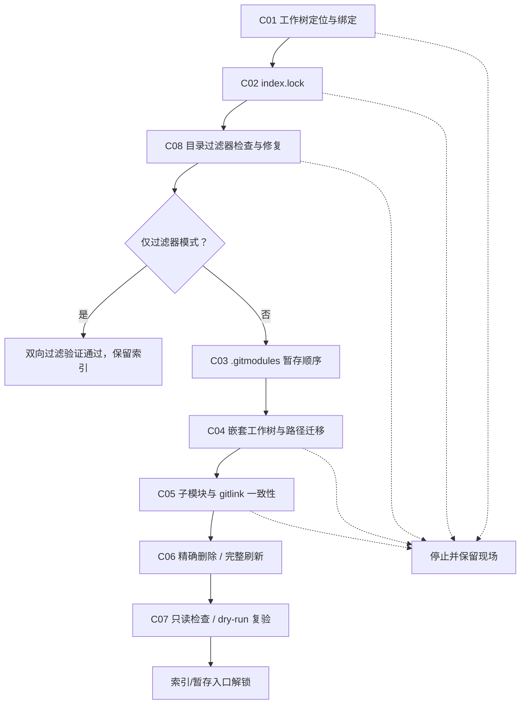

# `【MacOS@SourceTree】📥修复Git无法Commit.command`


<!-- jobs-toc:start -->
<!-- jobs-toc:source {"v":2,"token":"[toc]"} -->
<details>
<summary>📚 目录（点击展开 / 收起）</summary>

- [🔥 前言](#jobs-toc-heading-1)
- [一、脚本覆盖的故障场景与成因](#jobs-toc-heading-2)
  - [1.1、C01：工作树绑定错位为什么分两种处理](#jobs-toc-heading-3)
  - [1.2、C02：为什么不能直接删除 index.lock](#jobs-toc-heading-4)
  - [1.3、C04 与 C05：脚本怎样保护子模块真实修改](#jobs-toc-heading-5)
  - [1.4、C06：旧路径精确修复的范围](#jobs-toc-heading-6)
  - [1.5、C08：目录过滤器与 Node 入口](#filter-repair)
- [二、先分清“无法暂存”与“无法创建提交”](#jobs-toc-heading-8)
  - [2.1、Commit 界面背后有两段流程](#jobs-toc-heading-9)
  - [2.2、错误分流表](#jobs-toc-heading-10)
  - [2.3、运行脚本前的只读诊断](#jobs-toc-heading-11)
  - [2.4、身份、Hook 与签名的诊断边界](#jobs-toc-heading-12)
  - [2.5、脚本明确不处理的 Commit 故障](#jobs-toc-heading-13)
- [三、逐项试验并解锁的执行流程](#jobs-toc-heading-14)
- [四、运行方式](#run-modes)
  - [4.1、Sourcetree 自定义动作](#jobs-toc-heading-16)
  - [4.2、终端独立运行](#jobs-toc-heading-17)
  - [4.3、参数与修复范围](#jobs-toc-heading-18)
- [五、执行后核对与手工回退边界](#jobs-toc-heading-19)
  - [5.1、精确路径修复的索引备份与恢复](#jobs-toc-heading-20)
- [六、安全边界](#jobs-toc-heading-21)
- [七、日志文件](#jobs-toc-heading-22)
- [八、常见问题](#jobs-toc-heading-23)
  - [8.1、脚本会直接 Commit 吗？](#jobs-toc-heading-24)
  - [8.2、为什么不是发现一个错误就直接执行所有修复？](#jobs-toc-heading-25)
  - [8.3、文件与同名目录互换会怎样处理？](#jobs-toc-heading-26)
  - [8.4、为什么 C07 通过后 Sourcetree 仍可能 Commit 失败？](#jobs-toc-heading-27)
  - [8.5、为什么还要刷新 Sourcetree？](#jobs-toc-heading-28)
  - [8.6、为什么运行后新目录中的文件仍未暂存？](#jobs-toc-heading-29)
  - [8.7、显示“保留已有暂存内容的旧路径”怎么办？](#jobs-toc-heading-30)
  - [8.8、验证范围](#jobs-toc-heading-31)

</details>
<!-- jobs-toc:end -->

---

## <span id="jobs-toc-heading-1" data-jobs-toc="v2">🔥 <font id=前言>前言</font></span><!-- jobs-toc:heading-end -->

> 这是一个挂载到 [**Sourcetree**](https://www.sourcetreeapp.com/) 的 [**Git**](https://git-scm.com/) Commit 修复动作。脚本把“无法 Commit”拆成 8 个独立场景；默认识别文件变同名目录的情况，只处理旧文件删除，保护已有暂存选择；其它情况沿用完整修复流程。任一安全前提不成立就停止。

- 默认自动判断：`HEAD` 中的普通文件已变成同名真实目录时，进入旧路径精确修复；即使旧条目已经暂存删除，也能识别这种迁移。
- `--repair-paths`：显式限定为旧路径精确修复，不加入新目录内容，也不暂存无关修改；适合 `pathspec ... did not match any files` 或 `not removing ... recursively without -r`。
- `--repair-filters`：仅检查并修复本仓目录过滤器；使用实际可用的稳定 Node 入口，保留索引、正文、子模块与全局配置。
- `--stage-all`：显式使用完整修复流程，C06 会暂存当前仓库全部未忽略改动，包括原来未暂存的修改；运行前需确认该范围。参数与示例见[运行方式](#run-modes)。

## <span id="jobs-toc-heading-2" data-jobs-toc="v2">一、脚本覆盖的故障场景与成因 <a href="#前言" style="font-size:17px; color:green;"><b>🔼</b></a> <a href="#🔚" style="font-size:17px; color:green;"><b>🔽</b></a></span><!-- jobs-toc:heading-end -->

| 编号 | 故障现象 | 出现原因 | 独立处理 | 通过判据 |
| --- | --- | --- | --- | --- |
| C01 | Sourcetree 显示 `HEAD`、当前目录无法识别为工作树，或目录改名后仓库失联 | 当前目录的 `.git` 指针仍指向旧 gitdir，gitdir 内的 `core.worktree` 又指向旧路径或另一个真实目录 | 优先只读识别仓库与修复范围；精确路径模式不修复绑定，异常时停止；完整流程核对 gitdir 与 `core.worktree` 后修复绑定 | `git rev-parse --show-toplevel` 能从当前目标路径得到真实仓库根目录 |
| C02 | `Unable to create '.git/index.lock': File exists` | Git 索引写进程仍在运行，或 Git / Sourcetree 异常退出后留下残留 `index.lock` | 精确路径模式遇任何已有锁都停止；完整流程检查锁占用、同仓库索引写进程和锁 inode，仅归档已确认的残留锁 | 原锁不再阻塞，且现有索引仍可读取 |
| C08 | `clean filter jobs-markdown-toc failed`、Node 路径不存在，导致暂存或 `commit -a` 失败 | Node 升级移除了写入配置的版本目录 | C02 后、任何状态读取或暂存之前，核对自有安装记录，备份后更新本仓 clean / smudge 和安装记录；实际验证 Git 双向过滤 | 使用健康稳定 Node 入口；受控文档通过真实 clean / smudge，保留原索引与正文 |
| C03 | `please stage your changes to .gitmodules or stash them to proceed`，删除或迁移旧子模块时 Commit 中断 | Sourcetree 先执行 `git rm`，但 `.gitmodules` 的路径变更或删除尚未写入索引，配置与 gitlink 顺序不一致 | 只把 `.gitmodules` 先写入索引，再继续处理 gitlink | `.gitmodules` 的待提交状态已进入索引，Git 不再拒绝后续 gitlink 变更 |
| C04 | 子模块改名/复制后显示 `HEAD`，新目录借用旧 gitdir，或 `.git/core.worktree` 路径错位 | 直接移动/复制目录只改变了文件系统位置，没有同步 `.gitmodules`、`.git/modules`、`core.worktree` 与父仓 gitlink | 扫描嵌套 `.git` 文件；仅在路径、索引登记和远端 URL 能相互验证时修复迁移或创建独立 gitdir | 每个被接管路径都能验证为自身的有效 Git 工作树；无法证明安全时停止 |
| C05 | 父仓显示“未提交的子模块”，但子模块缺失、为空、已迁移、已退役，或父仓锁定提交不可用 | 父仓索引中的模式 `160000` gitlink、`.gitmodules` 和磁盘上的子模块工作树状态不一致 | 初始化缺失工作树、识别同 section 路径迁移、允许已从 `.gitmodules` 移除的旧 gitlink 退役，并保留子模块内部真实修改 | 所有仍有效的 gitlink 都有安全可用的工作树；不安全子模块会阻断全量暂存 |
| C06 | 文件变同名目录或旧路径已失效时，Sourcetree 的分步 `add` / `rm` 互相阻塞；典型报错为 `not removing ... recursively without -r` 或 `pathspec ... did not match any files` | GUI 仍按旧文件类型处理目录，或沿用已不在索引中的旧路径列表 | 精确路径模式仅在临时索引中移除可安全处理的旧普通文件条目；完整流程统一执行 `git add -A -- .` | 精确模式保留其它索引条目与新目录内容；完整流程一次性暂存新增、修改和删除 |
| C07 | 前面看似修好，但下一次 Commit 仍可能再次卡在索引入口 | 修复动作如果不复验，可能只移动了表面阻塞，索引本身仍不可读或 GUI 仍缓存旧路径 | 两种模式均检查无遗留锁且索引可读；完整流程另执行 `git add --dry-run -A -- .`，精确模式提示刷新并重新选择文件 | 索引读取成功且符合所选模式；精确模式不会借复验执行全量暂存 |

精确路径模式保留 C01–C07 的编号与日志，但跳过 C03–C05 的 `.gitmodules` 暂存、嵌套元数据修复和子模块初始化。两种模式发现未解决冲突都在暂存前停止。

### <span id="jobs-toc-heading-3" data-jobs-toc="v2">1.1、C01：工作树绑定错位为什么分两种处理 <a href="#前言" style="font-size:17px; color:green;"><b>🔼</b></a> <a href="#🔚" style="font-size:17px; color:green;"><b>🔽</b></a></span><!-- jobs-toc:heading-end -->

- `.git` 文件中的绝对 gitdir 直接使用，相对 gitdir 按当前工作树解析；子模块元数据以父仓共用 Git 目录的 `modules/` 为基准，兼容 linked worktree。
- 完整流程中，旧 `core.worktree` 路径已经不存在：通常是目录改名后元数据没有同步，脚本可以把 `core.worktree` 改为当前路径。
- 完整流程中，旧 `core.worktree` 路径仍真实存在：说明当前目录可能是复制品或误绑定副本。脚本不会抢占原工作树，而是复制 Git 元数据，让当前目录成为独立工作树，并保留原 `.git` 指针作为备份。
- 已选择精确路径模式时，只读核对工作树归属，不改写 `.git` 或 `core.worktree`；绑定错位时保留原状并停止。默认自动判断若无法解析 Git 根，仍沿用原元数据恢复流程；需要严格限定旧路径修复时显式传入 `--repair-paths`。

### <span id="jobs-toc-heading-4" data-jobs-toc="v2">1.2、C02：为什么不能直接删除 `index.lock` <a href="#前言" style="font-size:17px; color:green;"><b>🔼</b></a> <a href="#🔚" style="font-size:17px; color:green;"><b>🔽</b></a></span><!-- jobs-toc:heading-end -->

`index.lock` 可能代表 `git add`、`git commit`、`git checkout` 等索引写操作仍在进行。直接删除活锁会让两个写进程同时操作索引。精确路径模式保留任何已有锁并停止；完整流程只在以下条件全部满足时归档残留锁：

1、锁是普通文件，不是目录或符号链接。
2、`lsof` 没有发现锁文件持有者。
3、当前仓库没有仍可能写索引的 Git 进程。
4、检查前后锁的设备号与 inode 没有变化。
5、移动锁后 `git ls-files --stage` 仍能读取索引；失败时恢复原锁。

### <span id="jobs-toc-heading-5" data-jobs-toc="v2">1.3、C04 与 C05：脚本怎样保护子模块真实修改 <a href="#前言" style="font-size:17px; color:green;"><b>🔼</b></a> <a href="#🔚" style="font-size:17px; color:green;"><b>🔽</b></a></span><!-- jobs-toc:heading-end -->

- 父仓只提交 gitlink 指向的子模块提交，不会直接提交子模块工作区里的文件内容。
- 已存在子模块有内部修改时，脚本列出状态并保持原样；它不会执行 `reset`、`clean` 或替用户提交子模块。
- 缺失子模块会按 `.gitmodules` 尝试初始化，因此可能访问子模块远端。
- 同源副本需要新的独立 gitdir 时，目标 gitdir 已存在则停止并保留已有元数据，不修改它的 `core.worktree`、分支或索引。
- 父仓锁定提交已被远端历史重写移除时，脚本只保留本轮新克隆工作树的有效 clean `HEAD`；这可能形成依赖版本变化，提交前必须人工核对。

以上子模块处理仅属于完整流程；精确路径模式跳过这些步骤，也不移除模式 `160000` 的 gitlink。

### <span id="jobs-toc-heading-6" data-jobs-toc="v2">1.4、C06：旧路径精确修复的范围 <a href="#前言" style="font-size:17px; color:green;"><b>🔼</b></a> <a href="#🔚" style="font-size:17px; color:green;"><b>🔽</b></a></span><!-- jobs-toc:heading-end -->

- 仅处理索引中 stage 0、模式 `100644` / `100755` 的旧普通文件，且磁盘路径已经消失或变成同名真实目录。
- 候选路径相对 `HEAD` 不能有已暂存变化；检查包含 `intent-to-add`，已有暂存内容与部分暂存选择保留。
- 保留 `.gitmodules`、gitlink、`skip-worktree`、`assume-unchanged` 和符号链接；不穿越符号链接祖先，也不把“父目录已变成文件”误作普通删除。
- 取得独占 `index.lock` 后，保存原索引到真实 Git 元数据目录中的 `index.jobs-paths-before.<随机后缀>`，再用临时索引执行 `update-index --force-remove`。该命令只改索引，不删除磁盘文件或目录。
- 写回前核对其它条目的 mode、OID、stage 与 flags 不变，候选路径仍符合条件，真实索引仍与原备份逐字节一致；异常或并发变化时停止并保留真实索引。
- 新目录中的脚本、README、未跟踪文件及忽略文件都不会被自动加入索引。运行后由用户刷新 Sourcetree，再选择本次真正要提交的文件。
- 旧路径已经不在索引时，不重复执行 `git rm`；日志会提示“没有可安全移除的旧索引条目”。此时应刷新 GUI 缓存，不能把提示理解成又完成了一次路径删除。

### 1.5、<span id="filter-repair">C08：目录过滤器与 Node 入口</span> <a href="#前言" style="font-size:17px; color:green;"><b>🔼</b></a> <a href="#🔚" style="font-size:17px; color:green;"><b>🔽</b></a>

- 依赖目标仓库自带 `.jobs-markdown-toc/MarkdownToc.mjs`、精确文档清单和 Git 元数据中的自有安装记录；配置存在时还需要可实际执行的 [**Node.js**](https://nodejs.org/)。没有配置就跳过，不自动安装过滤器或 Node。
- 记录必须与本仓配置一致，生效值不能被更高优先级配置覆盖。遇到 `process` 驱动、记录缺失或不一致、非标准命令、符号链接或跨仓清单时停止，不接管其它过滤器。
- 从当前环境和系统常见工具位置查找并验证 Node，保留稳定入口，不把它解析成 Homebrew Cellar 版本目录。旧版本路径失效或仍使用 Cellar 版本目录时，精确更新本仓 clean / smudge 与安装记录，保留 `required=true`。
- 写前保存精确字段、原安装记录和拟写入值到当前 Git 元数据中的 `jobs-filter-backup-* / before.json`；修复后实际 Git 双向过滤验证失败则回滚本轮配置。并发修改项保留并报告，可按备份逐字段恢复，不能用整份配置覆盖。
- 探针使用隔离临时对象目录，不替换业务索引或正文；通过 `--repair-filters` 可只执行 C01、C02 和 C08。显式 `--repair-paths` 保持原来的仅索引路径修复范围，不改过滤器。
- 健康配置重复运行只验证，不重写。此动作只处理目标仓，不递归改写子仓；每个需要修复的子仓独立运行。

## <span id="jobs-toc-heading-8" data-jobs-toc="v2">二、先分清“无法暂存”与“无法创建提交” <a href="#前言" style="font-size:17px; color:green;"><b>🔼</b></a> <a href="#🔚" style="font-size:17px; color:green;"><b>🔽</b></a></span><!-- jobs-toc:heading-end -->

### <span id="jobs-toc-heading-9" data-jobs-toc="v2">2.1、Commit 界面背后有两段流程 <a href="#前言" style="font-size:17px; color:green;"><b>🔼</b></a> <a href="#🔚" style="font-size:17px; color:green;"><b>🔽</b></a></span><!-- jobs-toc:heading-end -->

Git 的提交链路不是一个动作：

1、`git add` / `git rm` 把工作区的最终状态写入索引，也就是暂存区。
2、`git commit` 读取索引，运行 Hook 和签名链路，再创建提交对象。

Sourcetree 的 Commit 界面会编排这两段流程，所以界面显示“Commit 失败”，根因可能只是前半段的某条 `git add` 或 `git rm` 失败。本脚本的 C01–C07 主要解锁工作树、Git 元数据、子模块、索引与暂存入口；它不会绕过提交后半段的身份、Hook、签名或冲突规则。

完整流程中的 `git add -A -- .` 会在当前仓库范围内统一记录新增、修改和删除；`--` 用于结束选项解析，避免以 `-` 开头的路径被当作命令参数。精确路径模式只暂存符合条件的旧文件删除，保留其它未暂存修改与新文件。

### <span id="jobs-toc-heading-10" data-jobs-toc="v2">2.2、错误分流表 <a href="#前言" style="font-size:17px; color:green;"><b>🔼</b></a> <a href="#🔚" style="font-size:17px; color:green;"><b>🔽</b></a></span><!-- jobs-toc:heading-end -->

| 报错或现象 | 根因方向 | 本脚本是否处理 | 先做什么 |
| --- | --- | --- | --- |
| `clean filter jobs-markdown-toc failed` / Node 路径不存在 | 本仓过滤器仍调用已移除的 Node 版本 | 是，C08 | 用 `--repair-filters` 修复并验证，保留现有暂存选择。 |
| `nothing to commit` | 索引没有相对 `HEAD` 的变化 | 否 | 查看 `git diff --cached`；确认是否真的有内容需要暂存。 |
| `unmerged files` | merge、rebase、cherry-pick 或 revert 冲突未解决 | 否 | 用 `git status` 找出冲突；解决后 `git add`，再运行对应的 `--continue`。 |
| `Author identity unknown` | `user.name` / `user.email` 缺失 | 否 | 查明配置来源，再决定写仓库级还是全局配置。 |
| `Unable to create '.git/index.lock': File exists` | Git 索引写进程仍在运行，或异常退出留下残留锁 | 是，C02 | 精确路径模式遇锁停止；完整流程只归档已确认无人占用的残留锁并复验索引。 |
| Hook 返回非零 | `pre-commit`、`commit-msg` 等质量门禁失败 | 否 | 阅读 Hook 原始输出；不要把 `--no-verify` 当成默认修复。 |
| GPG / SSH signing failed | 签名程序、密钥、agent 或 pinentry 异常 | 否 | 检查 `commit.gpgsign`、`gpg.format` 与 signing key。 |
| `.gitmodules` / gitlink 报错 | 子模块配置、路径与索引模式 `160000` 不一致 | 完整流程，C03–C05 | 先核对 `.gitmodules`、gitlink 与子模块工作树，不直接重置；精确路径模式跳过。 |
| `not removing ... recursively without -r` | 旧文件现在是同名目录，GUI 仍按文件执行 `git rm` | 是，C06 | 默认自动识别后精确暂存旧文件删除；保留目录内容，再刷新 Sourcetree 重新选择。 |
| `pathspec ... did not match any files` | 旧路径已不在索引，GUI 仍使用先前的删除列表 | 识别并提示，C06–C07 | 使用 `--repair-paths` 检查真实索引，刷新 Sourcetree；无候选时不伪造删除，也不全量暂存。 |
| `No space left on device` / 只读错误 | 磁盘、配额、挂载或权限问题 | 否 | 先处理系统资源，不要反复重建索引。 |

### <span id="jobs-toc-heading-11" data-jobs-toc="v2">2.3、运行脚本前的只读诊断 <a href="#前言" style="font-size:17px; color:green;"><b>🔼</b></a> <a href="#🔚" style="font-size:17px; color:green;"><b>🔽</b></a></span><!-- jobs-toc:heading-end -->

先在目标仓库运行：

```shell
git status --short --branch
git diff
git diff --cached
git rev-parse --show-toplevel
git rev-parse --absolute-git-dir
git ls-files -u
git submodule status --recursive
```

- `git diff` 显示尚未暂存的变化；`git diff --cached` 显示真正会进入下一次提交的变化。
- `git ls-files -u` 有输出时表示索引仍有未解决冲突，本脚本不会替用户决定冲突内容。
- `git rev-parse --absolute-git-dir` 能找到当前 worktree 真正使用的 Git 元数据目录；不能固定假设锁一定在仓库根目录的 `.git` 文件夹内。
- `git submodule status --recursive` 用于识别缺失、未初始化或提交指向变化的子模块。

如果错误明确指向 `index.lock`，再做精确锁检查：

```shell
git_dir="$(git rev-parse --absolute-git-dir)"
index_lock="${git_dir}/index.lock"
if [[ -e "$index_lock" ]]; then
  stat -f 'path=%N size=%z inode=%i modified=%Sm' "$index_lock"
  lsof -nP -- "$index_lock"
fi
pgrep -alf git
```

发现锁仍被持有，或存在可能写索引的 Git 进程时，应完成或退出对应操作后再试；不要杀进程，也不要手工删除锁。

### <span id="jobs-toc-heading-12" data-jobs-toc="v2">2.4、身份、Hook 与签名的诊断边界 <a href="#前言" style="font-size:17px; color:green;"><b>🔼</b></a> <a href="#🔚" style="font-size:17px; color:green;"><b>🔽</b></a></span><!-- jobs-toc:heading-end -->

```shell
git config --show-origin --get-regexp '^user\.(name|email)$'
git config --show-origin --get commit.gpgsign
git config --show-origin --get gpg.format
git config --show-origin --get user.signingkey
git config --show-origin --get core.hooksPath
find "$(git rev-parse --git-path hooks)" -maxdepth 1 -type f -perm -u+x -print
```

- `core.hooksPath` 有输出时，应检查它指向的目录，不能继续假设 Hook 位于默认 `.git/hooks`。
- `git commit --no-verify` 可能绕过团队质量门禁，只能用于已获允许的定位过程，不是长期修复方案。
- `git commit --no-gpg-sign` 可以辅助判断签名链路，但不能用于绕过仓库的强制签名规则。

### <span id="jobs-toc-heading-13" data-jobs-toc="v2">2.5、脚本明确不处理的 Commit 故障 <a href="#前言" style="font-size:17px; color:green;"><b>🔼</b></a> <a href="#🔚" style="font-size:17px; color:green;"><b>🔽</b></a></span><!-- jobs-toc:heading-end -->

以下问题会保留原始错误并返回失败：

- merge、rebase、cherry-pick 或 revert 的未解决冲突。
- `pre-commit`、`commit-msg` 等 Hook 返回非零。
- `user.name` / `user.email` 缺失。
- GPG / SSH 签名、agent 或 pinentry 故障。
- 文件权限、只读文件系统、磁盘空间或 Git 对象损坏。
- 用户没有任何已暂存变化，Git 返回 `nothing to commit`。

C07 在精确路径模式中只证明索引可读且无遗留锁，在完整流程中还验证全量暂存 dry-run；不承诺上述提交对象创建阶段的问题已经消失。

## <span id="jobs-toc-heading-14" data-jobs-toc="v2">三、逐项试验并解锁的执行流程 <a href="#前言" style="font-size:17px; color:green;"><b>🔼</b></a> <a href="#🔚" style="font-size:17px; color:green;"><b>🔽</b></a></span><!-- jobs-toc:heading-end -->



执行原则：

1、每个场景都有独立编号、独立函数、出现原因和通过日志。
2、前一项通过后才进入下一项；任何安全条件失败都会立即返回非零状态。
3、精确路径模式跳过 C03–C05，C06 只处理旧文件删除；完整流程只在 C06 执行一次父仓 `git add -A`。
4、C07 负责最终“解锁”判定；通过后仍需回到 Sourcetree 人工核对暂存范围。

## 四、<span id="run-modes">运行方式</span> <a href="#前言" style="font-size:17px; color:green;"><b>🔼</b></a> <a href="#🔚" style="font-size:17px; color:green;"><b>🔽</b></a>

### <span id="jobs-toc-heading-16" data-jobs-toc="v2">4.1、Sourcetree 自定义动作 <a href="#前言" style="font-size:17px; color:green;"><b>🔼</b></a> <a href="#🔚" style="font-size:17px; color:green;"><b>🔽</b></a></span><!-- jobs-toc:heading-end -->

1、在 Sourcetree 中选中目标仓库。
2、运行自定义动作 `📥修复Git无法Commit`。
3、脚本接收 `$REPO` 后无交互连续执行；场景编号、原因、处理结果和停止点会显示在输出窗口。
4、回到“文件状态”刷新，逐项核对暂存变更后再提交。

现有动作只需传 `$REPO`，脚本会自动判断范围。输出“旧路径精确修复”时保留新目录内容和其它暂存选择；输出“原完整修复流程”时会暂存当前仓库全部改动。

### <span id="jobs-toc-heading-17" data-jobs-toc="v2">4.2、终端独立运行 <a href="#前言" style="font-size:17px; color:green;"><b>🔼</b></a> <a href="#🔚" style="font-size:17px; color:green;"><b>🔽</b></a></span><!-- jobs-toc:heading-end -->

在当前 README 所在目录执行：

```shell
'./【MacOS@SourceTree】📥修复Git无法Commit.command' '/path/to/repository'
```

终端模式会先打印内置自述；按回车确认后才初始化日志并修改 Git 状态，按 `Ctrl+C` 可取消。传入仓库参数或使用相对脚本路径均不绕过确认；非 Sourcetree 且无法交互或读取确认失败时直接停止。

### <span id="jobs-toc-heading-18" data-jobs-toc="v2">4.3、参数与修复范围 <a href="#前言" style="font-size:17px; color:green;"><b>🔼</b></a> <a href="#🔚" style="font-size:17px; color:green;"><b>🔽</b></a></span><!-- jobs-toc:heading-end -->

> 在当前 README 所在目录执行，仓库路径为第一参数，可选模式为第二参数；未传仓库路径时采用启动工作目录。

| 第二参数 | 范围 | 副作用 |
| --- | --- | --- |
| 不传 | 默认自动判断；`HEAD` 普通文件变真实目录时采用精确模式，否则完整流程 | 以日志显示的所选范围为准；完整流程会全量暂存 |
| `--repair-paths` | 仅旧普通文件路径修复，C08 跳过 | 精确暂存删除，保存索引备份；不修改工作区、配置或 `HEAD` |
| `--repair-filters` | C01、C02、C08；不修绑定、不归档锁 | 备份后仅修本仓过滤器与安装记录；保留正文和索引 |
| `--stage-all` | C01–C08 完整流程 | 可能恢复元数据、归档残留锁、初始化子模块，并全量暂存 |

仅修复失效的目录过滤器，保留已暂存和未暂存的选择：

```shell
'./【MacOS@SourceTree】📥修复Git无法Commit.command' '/path/to/repository' --repair-filters
```

明确修复 Sourcetree 的旧路径列表：

```shell
'./【MacOS@SourceTree】📥修复Git无法Commit.command' '/path/to/repository' --repair-paths
```

确认需要把当前仓库所有变化写入暂存区：

```shell
'./【MacOS@SourceTree】📥修复Git无法Commit.command' '/path/to/repository' --stage-all
```

未知第二参数或多余参数会报错停止，不执行后续业务。不要省略第一参数而把模式选项写在仓库路径的位置。

## <span id="jobs-toc-heading-19" data-jobs-toc="v2">五、执行后核对与手工回退边界 <a href="#前言" style="font-size:17px; color:green;"><b>🔼</b></a> <a href="#🔚" style="font-size:17px; color:green;"><b>🔽</b></a></span><!-- jobs-toc:heading-end -->

脚本成功后，先刷新 Sourcetree，再核对：

```shell
git status --short --branch
git diff --cached --name-status
git diff --cached -- .gitmodules
git diff --cached --submodule
git ls-files -s | awk '$1 == 160000 { print $2, $4 }'
git_dir="$(git rev-parse --absolute-git-dir)"
if [[ -d "${git_dir}/jobs-stale-lock-backups" ]]; then
  find "${git_dir}/jobs-stale-lock-backups" -maxdepth 1 -type f -name 'index.lock.*.stale' -print
fi
find "$git_dir" -maxdepth 1 -type f -name 'index.jobs-paths-before.*' -print
```

验收重点：

1、`git status` 不再报告索引锁、工作树绑定或文件/目录暂存阻塞。
2、`git diff --cached --name-status` 中每一项都是用户准备提交的变化。
3、`.gitmodules` 和模式 `160000` 的 gitlink 变化相互匹配。
4、子模块内部真实修改仍留在子模块中，没有被脚本清理或替用户提交。
5、残留锁备份路径与日志一致；备份用于追溯，不需要在正常流程中自动恢复。

精确路径模式还需核对：新目录文件与无关修改仍保持原来的暂存状态，已有部分暂存内容没有被工作区新内容替换。本轮只处理旧文件删除，不意味着新目录内容已经可以提交。

如果暂存范围不正确，应在确认具体文件后使用 Sourcetree 或精确的 `git restore --staged -- <path>` 取消对应暂存，再重新核对。不要为了“回退脚本”执行 `git reset --hard` 或 `git clean`，它们会影响真实工作区内容。

### <span id="jobs-toc-heading-20" data-jobs-toc="v2">5.1、精确路径修复的索引备份与恢复 <a href="#前言" style="font-size:17px; color:green;"><b>🔼</b></a> <a href="#🔚" style="font-size:17px; color:green;"><b>🔽</b></a></span><!-- jobs-toc:heading-end -->

日志中的 `index.jobs-paths-before.<随机后缀>` 是本轮修复前的完整索引备份，不是工作区文件备份。linked worktree 的真实 Git 元数据目录可能位于仓库目录外，以日志与 `git rev-parse --path-format=absolute --git-path index` 的结果为准。

先在目标仓库只读查看所选备份里的暂存内容；将示例末尾替换为日志中的真实后缀：

```shell
index_path="$(git rev-parse --path-format=absolute --git-path index)"
backup_path="${index_path}.jobs-paths-before.<日志中的后缀>"
GIT_INDEX_FILE="$backup_path" git diff --cached --name-status
git diff --cached --name-status
```

- 临时索引构造、校验失败或写回前发现并发变化时，真实索引保持原样，无需为这些失败执行整份恢复；若日志已显示成功写回，则按当前索引状态核对。
- 已成功写回后，优先在 Sourcetree 核对本轮删除并按路径调整暂存。文件变目录后的同名路径可能还包含新暂存子项，回退前应一并核对，避免取消后来新增的暂存内容。
- 需要恢复整份索引时，必须先停下该仓库的索引写操作，确认修复后没有新的暂存、提交或分支操作，并在独占锁保护下恢复；存在后续变化时应按具体条目合并，不能直接用旧备份覆盖当前索引。脚本不提供自动恢复入口，也不会自动覆盖后来新增的暂存选择。
- 备份保留在 Git 元数据目录中，不进入本次提交；确认暂存结果前保留备份。

## <span id="jobs-toc-heading-21" data-jobs-toc="v2">六、安全边界 <a href="#前言" style="font-size:17px; color:green;"><b>🔼</b></a> <a href="#🔚" style="font-size:17px; color:green;"><b>🔽</b></a></span><!-- jobs-toc:heading-end -->

- 精确路径模式仅暂存符合条件的旧普通文件删除，不加入新目录子项、不修改工作区内容、Git 配置或 `HEAD`，不初始化子模块；保留其它暂存选择。
- 完整流程会修改当前仓库的 Git 索引，把所有未忽略的工作区变化放入暂存区；原来未暂存的修改也会进入索引。
- 精确路径模式保留任何已有索引锁并停止；完整流程仅将已确认的残留锁移动到真实 Git 元数据目录的 `jobs-stale-lock-backups/index.lock.<时间>.stale`，不会直接删除活锁。
- 完整流程中，缺失子模块可能触发 `git submodule update --init --recursive` 并访问远端。
- 完整流程中，经验证的子模块路径迁移可能修改 `.gitmodules`、`core.worktree`、父仓新旧 gitlink 和 `.git/modules` 内的元数据。
- 脚本不执行 `git commit`、`git push`、`git reset`、`git clean` 或 `git add -f`。
- 脚本不清理、不暂存、不提交已有子模块内部的真实文件修改。
- 执行后必须在 Sourcetree 检查暂存区；“流程解锁”不等于“所有暂存内容都应该提交”。

## <span id="jobs-toc-heading-22" data-jobs-toc="v2">七、日志文件 <a href="#前言" style="font-size:17px; color:green;"><b>🔼</b></a> <a href="#🔚" style="font-size:17px; color:green;"><b>🔽</b></a></span><!-- jobs-toc:heading-end -->

确认前只展示内置自述，不清空或写入旧日志；确认后才初始化本次日志。业务正文和路径按原文记录，反斜杠不会被解释为转义。

运行日志写入系统临时目录中的：

```text
【MacOS@SourceTree】📥修复Git无法Commit.log
```

日志包含所选修复范围、C01–C07 的执行或跳过顺序、命中原因、备份位置、子模块状态、暂存摘要和最终复验结果。精确路径模式会逐项输出“仅暂存旧文件删除”；无候选时明确提示刷新 Sourcetree。日志可能包含本机路径和远端信息，分享前应脱敏。

## <span id="jobs-toc-heading-23" data-jobs-toc="v2">八、常见问题 <a href="#前言" style="font-size:17px; color:green;"><b>🔼</b></a> <a href="#🔚" style="font-size:17px; color:green;"><b>🔽</b></a></span><!-- jobs-toc:heading-end -->

### <span id="jobs-toc-heading-24" data-jobs-toc="v2">8.1、脚本会直接 Commit 吗？ <a href="#前言" style="font-size:17px; color:green;"><b>🔼</b></a> <a href="#🔚" style="font-size:17px; color:green;"><b>🔽</b></a></span><!-- jobs-toc:heading-end -->

不会。脚本只处理 Commit 之前的工作树、Git 元数据和暂存区；提交仍由用户在 Sourcetree 中确认后执行。

### <span id="jobs-toc-heading-25" data-jobs-toc="v2">8.2、为什么不是发现一个错误就直接执行所有修复？ <a href="#前言" style="font-size:17px; color:green;"><b>🔼</b></a> <a href="#🔚" style="font-size:17px; color:green;"><b>🔽</b></a></span><!-- jobs-toc:heading-end -->

不同场景影响的对象不同：`index.lock` 属于并发保护，`.gitmodules` 属于配置与索引顺序，`core.worktree` 属于工作树绑定，gitlink 属于父仓对子模块提交的记录。逐项处理可以在第一个不安全点停止，并明确知道改了什么。

### <span id="jobs-toc-heading-26" data-jobs-toc="v2">8.3、文件与同名目录互换会怎样处理？ <a href="#前言" style="font-size:17px; color:green;"><b>🔼</b></a> <a href="#🔚" style="font-size:17px; color:green;"><b>🔽</b></a></span><!-- jobs-toc:heading-end -->

Sourcetree 可能针对旧文件、新目录和目录内容分别执行 `add` / `rm`，中间状态会触发递归删除或路径类型冲突。默认会识别 `HEAD` 普通文件变真实目录，只从索引中移除可安全处理的旧文件条目；新目录内容与无关修改保持原暂存状态。显式 `--stage-all` 则使用完整索引刷新，让 Git 统一记录最终工作树的新增、修改和删除；它会改变当前仓库全部未忽略文件的暂存范围。

### <span id="jobs-toc-heading-27" data-jobs-toc="v2">8.4、为什么 C07 通过后 Sourcetree 仍可能 Commit 失败？ <a href="#前言" style="font-size:17px; color:green;"><b>🔼</b></a> <a href="#🔚" style="font-size:17px; color:green;"><b>🔽</b></a></span><!-- jobs-toc:heading-end -->

C07 只验证所选模式下的索引入口：精确模式检查索引可读且无遗留锁，完整流程另有全量暂存 dry-run。Commit 后半段还可能被 Hook、作者身份、签名、磁盘或权限问题阻断；这些错误不由本脚本自动绕过。两种模式都会在发现未解决冲突时停止。

### <span id="jobs-toc-heading-28" data-jobs-toc="v2">8.5、为什么还要刷新 Sourcetree？ <a href="#前言" style="font-size:17px; color:green;"><b>🔼</b></a> <a href="#🔚" style="font-size:17px; color:green;"><b>🔽</b></a></span><!-- jobs-toc:heading-end -->

Git 索引由外部脚本修改后，Sourcetree 界面可能仍缓存旧文件列表。刷新后才能看到真实暂存状态。

`pathspec ... did not match any files` 尤其可能说明旧路径已经暂存删除，而 Sourcetree 仍重复调用旧的 `git rm` 列表。运行精确模式无候选时，刷新“文件状态”，取消旧选择并按当前列表重新选择；仍显示旧列表时重新打开仓库。不要为消除这条 GUI 旧路径错误执行 `git rm -r -f`，它可能删除现在已经存在的新目录内容。

### <span id="jobs-toc-heading-29" data-jobs-toc="v2">8.6、为什么运行后新目录中的文件仍未暂存？ <a href="#前言" style="font-size:17px; color:green;"><b>🔼</b></a> <a href="#🔚" style="font-size:17px; color:green;"><b>🔽</b></a></span><!-- jobs-toc:heading-end -->

这是精确路径模式的范围：只解除旧普通文件条目的暂存阻塞，不替用户决定新目录或无关文件的提交内容。刷新 Sourcetree 后选择需要的脚本与 README；已有部分暂存内容保留。只有确认需要全量暂存时才使用 `--stage-all`。

### <span id="jobs-toc-heading-30" data-jobs-toc="v2">8.7、显示“保留已有暂存内容的旧路径”怎么办？ <a href="#前言" style="font-size:17px; color:green;"><b>🔼</b></a> <a href="#🔚" style="font-size:17px; color:green;"><b>🔽</b></a></span><!-- jobs-toc:heading-end -->

该路径已经有相对 `HEAD` 的暂存变化，自动删除会覆盖用户的暂存意图，因此脚本保留它。先在 Sourcetree 比较该路径的已暂存与未暂存内容，再决定是否调整；不要把再次运行修复当成强制覆盖入口。

### <span id="jobs-toc-heading-31" data-jobs-toc="v2">8.8、验证范围 <a href="#前言" style="font-size:17px; color:green;"><b>🔼</b></a> <a href="#🔚" style="font-size:17px; color:green;"><b>🔽</b></a></span><!-- jobs-toc:heading-end -->

脚本使用 `zsh -n` 检查语法；完整流程的既有隔离验证覆盖 C01–C07、父仓暂存而脏子模块内容保留、绝对 gitdir 解析、linked worktree 共用 `modules/` 路径、已存在 alias gitdir 的保护、活锁保留、残留锁归档，以及非交互确认门禁。[路径修复回归](../Tests/CommitPathRepair.Tests.zsh/README.md)的 18 项完整入口测试通过，覆盖文件变目录、普通删除、旧路径与重复执行、部分暂存与 flags、特殊路径、符号链接、索引备份、冲突和锁停止、linked worktree 及 `--stage-all` 兼容。隔离索引验证不代替真实 Sourcetree 提交；Hook、签名与生产远端初始化仍按实际错误另行处理。

**终端配色保护：** 独立运行时，在支持完整保存与恢复配色的交互终端中临时使用黑底白字及统一强调色；正常结束、失败或可捕获中断后恢复进入前的配色，不修改终端全局偏好或 Shell 启动配置。不支持完整保护、无交互终端、`NO_COLOR`、既有纯文本模式和 Sourcetree 场景不切换配色，并沿用纯文本输出约定。强制终止（如 `kill -9`）无法由脚本自身保证恢复，请使用运行时显示的独立恢复入口。

<a id="🔚" href="#前言" style="font-size:17px; color:green; font-weight:bold;">我是有底线的➤点我回到首页</a>
