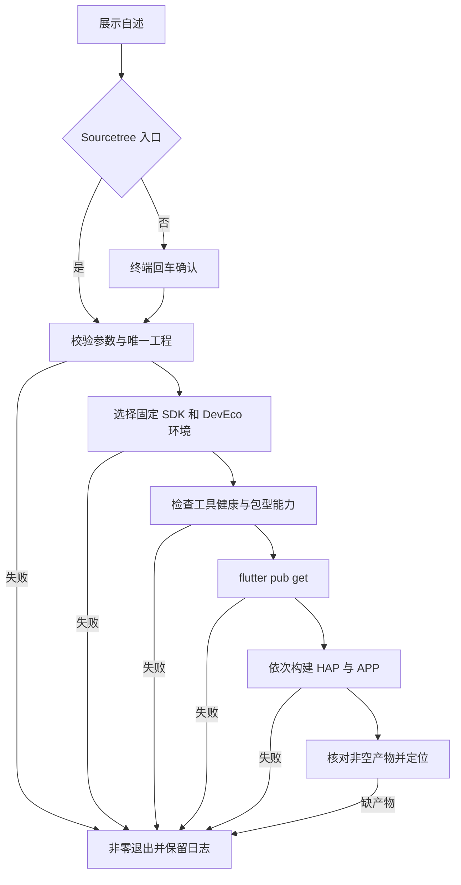

# `【MacOS@SourceTree】📦双击打包Flutter.ohos.command`


<!-- jobs-toc:start -->
<!-- jobs-toc:source {"v":2,"token":"[toc]"} -->
<details>
<summary>📚 目录（点击展开 / 收起）</summary>

- [🔥 前言](#%E5%89%8D%E8%A8%80)
- [一、Android 与鸿蒙包的区别](#package-types)
- [二、运行方式与参数](#usage)
- [三、环境与工程前提](#environment)
- [四、执行流程、日志与产物](#flow)
- [五、风险与验证边界](#risks-and-validation)

</details>
<!-- jobs-toc:end -->

---

## 🔥 <span id="前言">前言</span>

这是 [**Sourcetree**](https://www.sourcetreeapp.com/) 的 [**Flutter**](https://flutter.dev/) 鸿蒙打包动作，面向已经具备 `ohos/` 平台的工程。默认一次执行 `flutter build hap --release` 和 `flutter build app --release`，同时生成 HAP 安装模块与 APP 发布包；显式 CLI 参数仍兼容单包。构建命令来自 [CPF-Flutter 鸿蒙适配项目](https://gitcode.com/CPF-Flutter/flutter_flutter)，需要匹配工程的鸿蒙适配版 SDK。

菜单显示为 `📦打包生成HAP+APP文件（Flutter.ohos）`，与 Flutter Android / iOS 及原生 iOS 打包动作连续排列。脚本文件名与调用路径保持现有名称，菜单参数为 `$REPO --target all --mode release`。

## 一、<span id="package-types">Android 与鸿蒙包的区别</span> <a href="#前言" style="font-size:17px; color:green;"><b>🔼</b></a> <a href="#🔚" style="font-size:17px; color:green;"><b>🔽</b></a>

| 目标 | 包型与用途 | Flutter 命令 | 工具链 |
| --- | --- | --- | --- |
| [**Android**](https://developer.android.com/) | APK 安装包、AAB 发布包 | `flutter build apk` / `flutter build appbundle` | Android SDK、Gradle、Java |
| [**HarmonyOS**](https://developer.huawei.com/consumer/cn/harmonyos/) 原生应用 | HAP 安装模块、APP 发布包 | 鸿蒙适配 SDK 的 `flutter build hap` / `flutter build app` | HarmonyOS SDK、Hvigor、ohpm、Node.js、Java |

部分旧设备能安装 Android APK，使用的是系统兼容能力；将应用适配到鸿蒙原生平台需要独立构建。APP 包包含 HAP / HSP 及描述信息，具体发布要求见[华为应用程序包术语](https://developer.huawei.com/consumer/cn/doc/doccenter-getting-started/application-package-glossary)。此入口处理 Flutter 鸿蒙工程；纯 ArkTS / ArkUI 工程由其原生 Hvigor 流程构建。

## 二、<span id="usage">运行方式与参数</span> <a href="#前言" style="font-size:17px; color:green;"><b>🔼</b></a> <a href="#🔚" style="font-size:17px; color:green;"><b>🔽</b></a>

Sourcetree 自定义操作固定传入 `$REPO --target all --mode release`，显示完整输出、无交互连续执行。独立终端先展示内置自述，回车确认后执行，`Ctrl+C` 取消。非 Sourcetree 且没有 TTY 输入时停止，确认前不写日志、不修改工程；运行时不读取 README。

在本目录执行，SDK 路径替换为实际克隆或安装的鸿蒙适配 SDK 根目录：

```shell
zsh "./【MacOS@SourceTree】📦双击打包Flutter.ohos.command" \
  "<Flutter 工程目录>" \
  --flutter-sdk "<鸿蒙 Flutter SDK 根目录>" \
  --target all \
  --mode release
```

| 参数 / 环境变量 | 默认与作用 |
| --- | --- |
| 工程路径 | 位置参数优先，其次 `PROJECT_DIR`、`REPO`、当前目录。支持中文、空格、拖拽路径。 |
| `--target` | 默认固定 `all`，按 HAP、APP 顺序生成两种包，不读取遗留 `BUILD_TARGET` 环境值；CLI 可显式指定 `hap`、`app`。菜单固定 `all`。 |
| `--mode` / `BUILD_MODE` | `release`；可选 `debug`、`profile`。 |
| `--flutter-sdk` / `FLUTTER_OHOS_SDK` | 可选，指定含 `bin/flutter` 的 SDK 根目录。 |
| `DEVECO_STUDIO_HOME` / `TOOL_HOME` | 可选，DevEco 应用或其 `Contents`、独立 command-line-tools 根目录。 |
| `DEVECO_SDK_HOME` | HarmonyOS SDK 根目录；未设置时兼容 `HOS_SDK_HOME`，或从选定 DevEco 的 `sdk/` 推导。 |
| `JAVA_HOME` / `NODE_HOME` | 可选，显式设置时必须指向有效工具根目录。 |
| `OPEN_AFTER_BUILD` | `1`，成功后在 Finder 定位产物；设置 `0` 关闭。 |

命令行覆盖同名环境变量。SDK 选择依次为显式指定、工程 `.fvm/flutter_sdk`、当前 PATH；工程声明 FVM 而固定 SDK 不可用时停止，不改用全局版本，也不调用可能自动下载 SDK 的 FVM 转发。固定 SDK 不支持鸿蒙时同样停止。首次使用或 GUI 环境不能找到 SDK 时，可在 Sourcetree 该动作的 `$REPO` 后增加 `--flutter-sdk "<SDK 根目录>"`。

入口只使用工程默认 product / target，不提供 `--flavor`：部分适配 SDK 遇到未知 flavor 会退回 default，应先在工程中核对产品配置。

## 三、<span id="environment">环境与工程前提</span> <a href="#前言" style="font-size:17px; color:green;"><b>🔼</b></a> <a href="#🔚" style="font-size:17px; color:green;"><b>🔽</b></a>

工程必须包含 `pubspec.yaml`、`lib/`、`ohos/build-profile.json5` 和 `ohos/oh-package.json5`，插件也必须支持鸿蒙。可向上定位工程，或在传入目录下查找唯一工程；多工程目录必须明确指定。扫描排除 `.git`、`node_modules`、`Pods`、`.dart_tool`、`.fvm`、`build`、`DerivedData` 等依赖和产物目录。

依赖链为：鸿蒙 Flutter / Dart → HarmonyOS SDK → Node.js / npm、ohpm、Hvigor、Java。脚本实际执行版本检查，再检查每种所选包型的 `flutter build <包型> --help`；任一步失败均停止。没有 DevEco、SDK 或命令时给出诊断，不自动安装、升级或下载工具链。

只有一个已安装的 `DevEco*.app` 且未指定 SDK 时，自动复用其工具目录；多个版本要求显式选择。DevEco 常见工具路径为 `Contents/tools/{node,ohpm,hvigor}/bin`，独立命令行工具为 `tool/node/bin`、`ohpm/bin`、`hvigor/bin`；实际版本以[官方环境指导](https://gitcode.com/CPF-Flutter/flutter_samples/blob/master/ohos/docs/03_environment/OpenHarmony-flutter环境搭建指导.md)及工程要求为准。

`OHOS_SDK_HOME` 与 `DEVECO_SDK_HOME` 对应的 SDK 结构和探测分支不同，脚本不将二者无条件互设。适配 SDK 已保存的 `flutter config --ohos-sdk` 设置可能优先于环境变量，异常时应同时核对现有 Flutter 配置与构建日志。Java 沿用现有配置或 DevEco 自带 JBR，不固定升级主版本。profile 模式需要工程已有对应 `buildModeSet`，脚本不自动改工程配置。

## 四、<span id="flow">执行流程、日志与产物</span> <a href="#前言" style="font-size:17px; color:green;"><b>🔼</b></a> <a href="#🔚" style="font-size:17px; color:green;"><b>🔽</b></a>

完成参数、工程和工具链检查后执行：

```shell
flutter pub get
flutter build hap --release
flutter build app --release
# 显式 --target hap 或 app 时只执行对应单包构建。
```

默认双包目标会在依赖解析前同时验证 SDK 的 HAP 与 APP 构建能力，任一种不支持都停止；两次构建、各阶段非空产物核对与最终已记录双包存续复核均成功才报告整体成功，第二次构建失败保留已生成的 HAP 并返回失败。依赖源沿用工程、锁文件与现有 Pub / ohpm 配置。构建实时输出并记录到系统临时目录的 `【MacOS@SourceTree】📦双击打包Flutter.ohos.log`。Sourcetree、非彩色终端及设置 `NO_COLOR` 时使用纯文本，日志过滤 ANSI 控制码；外部命令或日志管道失败均返回非零状态。

不同适配 SDK 构建路径存在差异，入口扫描以下工程内目录中的非空 `.hap` / `.app` 文件，并打印完整实际路径：

- `build/ohos/`：部分版本汇总到其中的 `hap/`、`app/`。
- `ohos/entry/build/` 等直属模块的 `build/`：常见 HAP 位于 `default/outputs/default/`。
- `ohos/build/`：常见 APP 位于 `outputs/default/`。

签名完全沿用工程配置，脚本不创建或读取证书秘密。发现 `-unsigned` 产物会提醒补签名；构建成功不代表已经通过安装、签名校验或应用市场审核。产物目录可能含以往构建结果，具体 mode、签名及发布时间应结合本次构建日志核对。



## 五、<span id="risks-and-validation">风险与验证边界</span> <a href="#前言" style="font-size:17px; color:green;"><b>🔼</b></a> <a href="#🔚" style="font-size:17px; color:green;"><b>🔽</b></a>

执行会联网解析依赖、运行工程及其依赖的构建代码，并写入锁文件、缓存、平台构建配置和产物。仅在当前脚本进程及子进程配置工具路径，不修改 Shell 启动文件或系统代理，不清理旧产物、不提交、不推送、不上传市场。

脚本与安装器的运行、备灾两副本均通过 `zsh -n` 与逐字节一致性核验。[隔离回归](../Tests/FlutterHarmonyBuild.Tests.rb) 使用临时工程和假工具验证默认双包、CLI 单包兼容、菜单参数覆盖遗留环境、APP 能力缺失时不拉依赖、第二步失败、缺少 APP 产物，以及 APP 构建清掉 HAP 后最终复核失败。当前用户菜单写入前已备份，保留其它动作和用户标题；正常重启 Sourcetree 后已在“自定义操作”页面实际核对原显示标题、运行副本路径及 `$REPO --target all --mode release` 参数，未点击执行打包。

这些检查独立于真实打包。真实鸿蒙 SDK、工程插件适配、签名、设备安装和上架仍须使用目标工程验证；本仓维护过程未执行真实鸿蒙构建。

<a id="🔚" href="#前言" style="font-size:17px; color:green; font-weight:bold;">我是有底线的➤点我回到首页</a>
