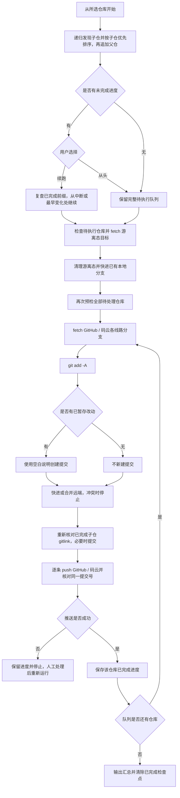

# `【MacOS@SourceTree】🚀逐层空白提交并Push.command`


<!-- jobs-toc:start -->
<!-- jobs-toc:source {"v":2,"token":"[toc]"} -->
<details>
<summary>📚 目录（点击展开 / 收起）</summary>

- [🔥 前言](#jobs-toc-heading-1)
- [一、脚本用途](#jobs-toc-heading-2)
- [二、适用场景](#jobs-toc-heading-3)
- [三、运行方式](#jobs-toc-heading-4)
  - [3.1、Sourcetree 自定义动作](#jobs-toc-heading-5)
  - [3.2、终端独立运行](#jobs-toc-heading-6)
  - [3.3、中断后继续或重来](#jobs-toc-heading-7)
- [四、执行前检查](#jobs-toc-heading-8)
- [五、执行流程](#jobs-toc-heading-9)
- [六、风险说明](#jobs-toc-heading-10)
- [七、日志文件](#jobs-toc-heading-11)
- [八、常见问题](#jobs-toc-heading-12)
  - [8.1、在大仓运行，能提交子仓的改动吗？](#jobs-toc-heading-13)
  - [8.2、为什么某层没有新 commit？](#jobs-toc-heading-14)
  - [8.3、为什么 push 后不继续外层？](#jobs-toc-heading-15)
  - [8.4、为什么打印自述后立即退出，文件名还出现乱码？](#jobs-toc-heading-16)
  - [8.5、游离 HEAD 如何恢复？](#jobs-toc-heading-17)
  - [8.6、出现未解决冲突后怎样继续？](#jobs-toc-heading-18)
  - [8.7、为什么提示“无法读取远端分支”？](#jobs-toc-heading-19)
  - [8.8、GitHub 和码云如何同时推送？](#jobs-toc-heading-20)
  - [8.9、Sourcetree 为什么只显示终端启动结果？](#jobs-toc-heading-21)
  - [8.10、为什么显示“处理完成”后仍报 unmatched 引号错误？](#jobs-toc-heading-22)
  - [8.11、验证范围](#jobs-toc-heading-23)

</details>
<!-- jobs-toc:end -->

---

## <span id="jobs-toc-heading-1" data-jobs-toc="v2">🔥 <font id=前言>前言</font></span><!-- jobs-toc:heading-end -->

> 用一次 [**Sourcetree**](https://www.sourcetreeapp.com/) 自定义动作，递归发现当前仓库管理的子仓，按“子仓提交、子仓推送、父仓更新 gitlink”的顺序由内向外处理，直到最外层 [**Git**](https://git-scm.com/) 仓库。

## <span id="jobs-toc-heading-2" data-jobs-toc="v2">一、脚本用途 <a href="#前言" style="font-size:17px; color:green;"><b>🔼</b></a> <a href="#🔚" style="font-size:17px; color:green;"><b>🔽</b></a></span><!-- jobs-toc:heading-end -->

- 暂存当前层仓库的全部已跟踪、未跟踪和删除改动。
- 有改动时创建“提交说明为空白”的正常提交；没有改动时不制造无意义的空提交。
- 正常分支先 fetch 每条推送线路，再提交本地改动、整合全部远端历史；最后把同一个 HEAD 逐条 push，并核对各线路提交号。没有文件改动时也会同步远端和补推已有提交。
- 每仓复用已有的一个本地工作分支，一份代码同步到 [**GitHub**](https://github.com) / [**Gitee**](https://gitee.com) 各自目标分支；目标分支名可以不同。脚本不新建本地分支，不创建、更新或推送辅助本地分支。
- 远端查询、fetch、push 遇到超时、空响应或连接中断时最多尝试 3 次；认证、权限、证书及推送拒绝直接停止。重试只重复该条网络命令。
- 每个仓库全部线路推送并核验后保存进度；中断后重新运行，由用户选择从中断处继续或从头执行。
- 当前层全部线路推送并核验成功后才进入父仓，使父仓提交的 gitlink 指向已经上传的子仓提交。父仓整合远端后再次核对子仓指针；若快进或合并改变了已完成子仓的 gitlink，会重新暂存这些直接子仓并创建必要提交。
- 处理“当前仓库管理的全部子仓 → 当前仓库 → 上层父仓”；从子仓发起时，不扩展扫描上层的兄弟仓库。

## <span id="jobs-toc-heading-3" data-jobs-toc="v2">二、适用场景 <a href="#前言" style="font-size:17px; color:green;"><b>🔼</b></a> <a href="#🔚" style="font-size:17px; color:green;"><b>🔽</b></a></span><!-- jobs-toc:heading-end -->

- 大 Git 仓库内以子模块或独立 `.git` 目录嵌套小 Git 仓库。
- 个人项目允许留空 commit message，并希望一次动作完成整条父仓链推送。
- 可以直接从大仓发起，递归提交、推送其管理的子仓；也可以从小仓发起，只处理该子树及其父仓链。

## <span id="jobs-toc-heading-4" data-jobs-toc="v2">三、运行方式 <a href="#前言" style="font-size:17px; color:green;"><b>🔼</b></a> <a href="#🔚" style="font-size:17px; color:green;"><b>🔽</b></a></span><!-- jobs-toc:heading-end -->

### <span id="jobs-toc-heading-5" data-jobs-toc="v2">3.1、Sourcetree 自定义动作 <a href="#前言" style="font-size:17px; color:green;"><b>🔼</b></a> <a href="#🔚" style="font-size:17px; color:green;"><b>🔽</b></a></span><!-- jobs-toc:heading-end -->

1、在要处理的大仓或小仓上打开“自定义操作”。

2、选择“🚀逐层空白提交并Push（识别父Git）”。

3、Sourcetree 传入 `$REPO` 后，脚本打开新的 Terminal.app 窗口；在终端按回车确认后执行，实时查看每层提交、GitHub / 码云推送及核验日志。

4、执行结束后终端保留日志和退出码；Sourcetree 输出只表示终端启动结果，不能用来判断推送是否成功。

### <span id="jobs-toc-heading-6" data-jobs-toc="v2">3.2、终端独立运行 <a href="#前言" style="font-size:17px; color:green;"><b>🔼</b></a> <a href="#🔚" style="font-size:17px; color:green;"><b>🔽</b></a></span><!-- jobs-toc:heading-end -->

```shell
chmod +x './【MacOS@SourceTree】🚀逐层空白提交并Push.command'
'./【MacOS@SourceTree】🚀逐层空白提交并Push.command' '/path/to/repository'
```

终端模式首先展示内置自述，并等待回车确认；检测到游离态时，先逐项列出即将舍弃内容的仓库完整路径、恢复分支和本次 fetch 得到的目标提交号，再要求输入完整 `YES` 才执行清理。从 Sourcetree 打开的终端采用相同确认流程；其它输入取消恢复。

### <span id="jobs-toc-heading-7" data-jobs-toc="v2">3.3、中断后继续或重来 <a href="#前言" style="font-size:17px; color:green;"><b>🔼</b></a> <a href="#🔚" style="font-size:17px; color:green;"><b>🔽</b></a></span><!-- jobs-toc:heading-end -->

人工处理网络、权限或冲突后，对同一个起始仓库再次运行。发现未完成进度时显示已完成数量和中断仓库，必须输入以下选项之一：

1、从中断处继续：跳过分支、提交、有效 Git 配置和工作区均未变化的已完成仓库，只处理剩余队列。发现变化时，从最早变化的仓库重新执行。

2、从头执行：重新检查并处理全部仓库。`Ctrl+C` 取消，保留已有进度。

进度保存在起始仓库实际 Git 管理目录中的 `jobs-layered-push.state`，不进入源码提交；每完成一仓原子更新，全部完成后删除。只有全部推送线路均核验成功的仓库才算完成；失败仓库即使部分线路已成功，续跑仍从该仓库的获取、整合与推送流程开始。父仓继续使用已完成子仓的最新 gitlink。

旧版没有检查点时，可从上一份失败日志迁移：要求起始仓库和完整队列逐项一致；用户选择续跑后，对已完成前缀只读查询当前各远端提交号，核验成功才跳过，不重复 fetch、commit 或 push。失败日志保留在原日志旁的 `.log.previous` 文件，取消选择不会覆盖它。日志缺失、队列变化或检查点损坏时，不猜测跳过位置；保留原进度并允许选择从头执行。

普通续跑复用上次已核验的远端结果，只复查本地状态；需要重新确认所有远端当前状态时选择从头执行。

## <span id="jobs-toc-heading-8" data-jobs-toc="v2">四、执行前检查 <a href="#前言" style="font-size:17px; color:green;"><b>🔼</b></a> <a href="#🔚" style="font-size:17px; color:green;"><b>🔽</b></a></span><!-- jobs-toc:heading-end -->

- 游离 HEAD 会先解析远端目标和已有本地恢复分支并 fetch 最新提交；全部仓库准备成功后，才清理游离态并恢复该本地分支。目标不明确、本地分支缺失时停止，不自动创建分支。正常分支不执行重置。
- 每层不能存在未解决冲突、未完成的 rebase、cherry-pick、revert 或 bisect。正常分支的 merge 若冲突已全部解决并暂存，允许续跑并完成合并提交；即使最终文件内容与 HEAD 相同，也会创建必要的合并提交。
- 每层优先使用已配置的 upstream；未配置时保留 `origin` 优先，否则接受唯一远端，或多个远端中的唯一 GitHub 线路。`Github` / `码云` 等改名按实际地址识别；存在多个 GitHub 候选且没有 `origin` 时停止，不按名称排序猜测。
- 首次执行的预检覆盖全部队列；续跑先复查已完成前缀的本地状态，再统一预检剩余子仓、当前仓库及上层父仓。其中任意待处理仓库不满足条件，本轮队列都不开始暂存或提交。
- `JobsOCBaseConfigDemo@ByPods` 使用 GitHub 完整历史和 Gitee 独立零点快照。队列包含该工程时，在 Fetch、恢复、暂存或推送前停止；应使用该工程原生推送窗口或明确的快照映射。

## <span id="jobs-toc-heading-9" data-jobs-toc="v2">五、执行流程 <a href="#前言" style="font-size:17px; color:green;"><b>🔼</b></a> <a href="#🔚" style="font-size:17px; color:green;"><b>🔽</b></a></span><!-- jobs-toc:heading-end -->



## <span id="jobs-toc-heading-10" data-jobs-toc="v2">六、风险说明 <a href="#前言" style="font-size:17px; color:green;"><b>🔼</b></a> <a href="#🔚" style="font-size:17px; color:green;"><b>🔽</b></a></span><!-- jobs-toc:heading-end -->

- `git add -A` 会把当前层仓库范围内的全部可跟踪改动放入同一个提交，包括新增、修改和删除。
- 正常分支采用 `各线路 fetch → 提交本地改动 → 整合各线路历史 → 各线路 push → 核对同一提交号`；落后时快进，分叉时合并，不执行 rebase 或强制推送。合并会保留双方历史，必要时新增合并提交；冲突时停止并保留本地提交及冲突现场。只有游离态恢复使用 `reset --hard` 和 `clean -fd`。
- 游离态独有提交不会合入恢复分支；未提交的已跟踪内容和非忽略的未跟踪文件会被舍弃。恢复前再次检查本地分支存在、历史可快进且未被其它工作树占用，使用禁止自动猜测的分支切换；不会使用 `clean -x` 或双重 `-f`，忽略文件及未跟踪嵌套 Git 仓库保留，后者若阻挡切换会报错停止。
- 脚本不绕过 Git hooks，也不关闭提交签名。项目本身禁止空白提交说明时，会在该层失败并停止。
- 如果下层已经提交但 push 失败，该本地提交会保留；上层不会被继续处理。

## <span id="jobs-toc-heading-11" data-jobs-toc="v2">七、日志文件 <a href="#前言" style="font-size:17px; color:green;"><b>🔼</b></a> <a href="#🔚" style="font-size:17px; color:green;"><b>🔽</b></a></span><!-- jobs-toc:heading-end -->

终端窗口实时显示进度；输出与 Git 命令结果同步写入系统临时目录中的 `【MacOS@SourceTree】🚀逐层空白提交并Push.log`。

## <span id="jobs-toc-heading-12" data-jobs-toc="v2">八、常见问题 <a href="#前言" style="font-size:17px; color:green;"><b>🔼</b></a> <a href="#🔚" style="font-size:17px; color:green;"><b>🔽</b></a></span><!-- jobs-toc:heading-end -->

### <span id="jobs-toc-heading-13" data-jobs-toc="v2">8.1、在大仓运行，能提交子仓的改动吗？ <a href="#前言" style="font-size:17px; color:green;"><b>🔼</b></a> <a href="#🔚" style="font-size:17px; color:green;"><b>🔽</b></a></span><!-- jobs-toc:heading-end -->

可以。脚本递归读取 Git 索引中模式为 `160000` 的 gitlink，兼容 `.git` 文件形式的子模块和 `.git` 目录形式的受管理嵌套仓。最深子仓先提交并推送，父仓随后暂存新 gitlink，直到当前大仓及其上层父仓处理完成。例如从 `JobsGenesis` 发起，会先处理 `SourceTree.command` 的文件改动，再提交大仓中的子仓指针。

未被 Git 索引登记的独立嵌套仓不自动纳入。默认跳过路径包含 `.git`、`node_modules`、`Pods`、`.dart_tool`、`build`、`DerivedData` 的子仓，并打印跳过提示；该排除仅控制子仓遍历，不改变各仓原有 `git add -A` 的暂存范围。已登记但未初始化或损坏的子仓会阻止本次执行，需先恢复工作区。

从大仓发起会处理它管理的全部非排除子仓，不限于当前有改动的子仓；干净子仓仍尝试 push。任何仓库预检失败都会在暂存前停止；执行中某仓拉取、提交、整合、推送或核验失败会停止剩余队列，已完成的提交和推送保留。

### <span id="jobs-toc-heading-14" data-jobs-toc="v2">8.2、为什么某层没有新 commit？ <a href="#前言" style="font-size:17px; color:green;"><b>🔼</b></a> <a href="#🔚" style="font-size:17px; color:green;"><b>🔽</b></a></span><!-- jobs-toc:heading-end -->

该层在 `git add -A` 后没有已暂存差异。脚本仍会执行 push，用于上传本地已有的未推送提交。

### <span id="jobs-toc-heading-15" data-jobs-toc="v2">8.3、为什么 push 后不继续外层？ <a href="#前言" style="font-size:17px; color:green;"><b>🔼</b></a> <a href="#🔚" style="font-size:17px; color:green;"><b>🔽</b></a></span><!-- jobs-toc:heading-end -->

该层拉取、整合、push 或远端提交号核验失败。查看日志中的冲突、鉴权、网络或 hook 信息后处理。fetch 后若远端再次被其他进程推进，push 仍可能被拒绝；重新运行会再次拉取并整合。同步成功指核验时两端分支提交一致，不意味着禁止远端以后继续产生提交。

### <span id="jobs-toc-heading-16" data-jobs-toc="v2">8.4、为什么打印自述后立即退出，文件名还出现乱码？ <a href="#前言" style="font-size:17px; color:green;"><b>🔼</b></a> <a href="#🔚" style="font-size:17px; color:green;"><b>🔽</b></a></span><!-- jobs-toc:heading-end -->

脚本直接保留 `$0` 的原始路径，并在路径解析及首行输出前设置当前进程的 UTF-8 环境；日志初始化失败会明确打印目标路径。环境识别也避免使用会提前关闭管道的 `grep -q`，以免与 `PIPE_FAIL` 组合产生误判。

若日志文件中文正常、只有 Sourcetree 输出窗口乱码，说明还需检查窗口的解码设置；子进程的 locale 不能强制改变宿主窗口的解码方式。

### <span id="jobs-toc-heading-17" data-jobs-toc="v2">8.5、游离 HEAD 如何恢复？ <a href="#前言" style="font-size:17px; color:green;"><b>🔼</b></a> <a href="#🔚" style="font-size:17px; color:green;"><b>🔽</b></a></span><!-- jobs-toc:heading-end -->

优先使用父仓 `.gitmodules` 声明的远端目标分支；分支为 `.` 时使用父仓当前分支。未声明时优先读取已有本地分支在所选远端的唯一上游目标，没有配置时再查询远端公布的默认分支，不猜测 `main` 或 `master`。远端优先选择 `origin`，不存在时使用唯一远端或唯一 GitHub 线路；多个 GitHub 候选、多个不同上游目标均停止。

本地恢复分支优先按 `branch.<本地分支>.remote / merge` 匹配该远端目标，允许本地分支名和远端目标名不同；没有匹配配置时只接受已经存在的同名本地分支。匹配到多个分支、本地目标分支不存在或无法唯一确定映射时，在清理前停止；不会通过 `switch -c / -C` 或远端自动跟踪新建分支。

先检查全部仓库的冲突、未完成操作及推送条件，并对所有游离仓定向 fetch，将恢复目标固定为本次获取的提交。全部准备成功后才清理；fetch 失败不会进入清理阶段，但已成功 fetch 的远端跟踪引用会保留。

舍弃确认前，按实际执行顺序单独列出所有待恢复的游离仓库：每项显示仓库完整路径、`本地分支 → 远端/目标分支` 和目标提交号，不混入正常分支仓库。该清单同时写入日志，确认范围以这份清单为准。

恢复时只处理仍处于游离态的仓库：再次检查恢复分支后，清掉已跟踪改动和非忽略的未跟踪文件，切换到已有本地分支，快进到本次获取的目标提交，并设置 upstream。不递归重置子模块；最终仍按子仓先、父仓后的顺序提交及推送。游离态独有提交不会推送，不主动清理 reflog 或 Git 对象。

目标本地分支含远端没有的提交、被其它工作树占用、忽略文件与目标路径冲突，或目标版本改变子仓目录结构时都会停止，避免覆盖正常分支历史或破坏已发现的子仓。执行中失败不自动回滚已完成的恢复；日志会保留已经恢复的仓库。

### <span id="jobs-toc-heading-18" data-jobs-toc="v2">8.6、出现未解决冲突后怎样继续？ <a href="#前言" style="font-size:17px; color:green;"><b>🔼</b></a> <a href="#🔚" style="font-size:17px; color:green;"><b>🔽</b></a></span><!-- jobs-toc:heading-end -->

脚本会打印冲突文件清单，并停止暂存和推送。先按文件内容解决冲突，再用 `git add` 标记解决；重新运行即可完成待提交的合并，再继续拉取、整合和推送。脚本不自动选择本地或远端整份覆盖。仍有冲突、处于 rebase 等其它操作，或游离状态下存在未完成合并时继续停止。

### <span id="jobs-toc-heading-19" data-jobs-toc="v2">8.7、为什么提示“无法读取远端分支”？ <a href="#前言" style="font-size:17px; color:green;"><b>🔼</b></a> <a href="#🔚" style="font-size:17px; color:green;"><b>🔽</b></a></span><!-- jobs-toc:heading-end -->

这是 `git ls-remote` 查询失败，不等于仓库没有分支，也不等于存在文件冲突。查询成功但返回空列表才视为远端分支尚不存在；标准错误与引用数据分开，查询失败时丢弃残余引用数据。

默认分支查询、提交前查询、fetch、push 和推送后核验统一处理短暂传输故障：`Operation timed out`、`Empty reply from server`、连接中断、域名解析失败及服务端 `500 / 502 / 503 / 504` 响应最多尝试 3 次，重试前分别等待 1 秒、2 秒。日志显示操作阶段、失败次数和退出码，恢复后明确打印成功；fetch / push 输出仍实时显示。脚本沿用现有 Git 网络配置，不修改全局代理、远端地址或证书校验。

认证、权限、证书、非快进及 hook 拒绝不属于这类传输故障，首次失败就停止。重试只重复同一条查询、fetch 或 push 命令，不重新执行暂存、提交、合并或游离态清理。push 重试仍发送同一 HEAD 与目标分支；若此前已经到达服务端，重试可能显示 `Everything up-to-date`，随后仍须读取远端提交号核验。

查询和 fetch 是独立阶段。日志先出现“远端查询失败（1/3）”，随后查询恢复成功，并不代表 fetch 也成功；应查看后面的“远端获取”阶段错误。连续网络失败会停止剩余队列，保留已经完成的仓库状态；持续网络问题仍需检查连接或代理。

浏览器能打开仓库，而 Git 提示连接 `github.com:443` 超时，可能是两者使用的网络路径不同。脚本在没有显式 Git 代理或代理环境变量时，为 HTTP(S) 请求临时使用 macOS 对应协议的手动系统代理；查询、fetch、push 和最终核验采用同一规则。命令结束即失效，不写全局或仓库 Git 配置，不修改远端地址。按远端名称设置的代理、URL 专属配置、显式空代理值和 `NO_PROXY` 等用户配置继续优先；同一地址的远端专属代理相互冲突时停止。系统旁路支持精确主机、通配符及简单主机名设置；SSH 线路保持原方式。

只支持系统手动 HTTP / HTTPS 代理，不执行 PAC，也不从 SOCKS 设置推导 HTTP 代理。代理无效或线路失败会明确报错并保留非零退出码，不自动切换直连或关闭证书校验。

### <span id="jobs-toc-heading-20" data-jobs-toc="v2">8.8、GitHub 和码云如何同时推送？ <a href="#前言" style="font-size:17px; color:green;"><b>🔼</b></a> <a href="#🔚" style="font-size:17px; color:green;"><b>🔽</b></a></span><!-- jobs-toc:heading-end -->

每个仓库按自己的 remote 配置识别线路，支持 [**GitHub**](https://github.com) 与 [**码云 Gitee**](https://gitee.com)：主上游的全部 push URL 始终纳入；其它远端按 `github.com` / `gitee.com` 完整主机识别，兼容 HTTPS、scp SSH、`ssh://`、用户名和端口。远端可以叫 `Github`、`码云`、`origin`、`gitee` 或其它名称；非官方网络主机不会仅凭平台别名被自动纳入。本地路径镜像兼容 `github` / `gitee` / `码云` 别名。相同地址去重，映射冲突时停止；也支持一个 remote 配置多个 push URL。

通常使用主上游配置的目标分支名（未配置时使用当前本地分支名）。`JobsGenesis`、`JobsBaseConfig` 及其下属仓库默认采用固定码云规则：按地址识别码云，远端名称不受限制，远端目标分支默认仍为 `gitee`；GitHub 使用主上游目标分支。例如当前 `main` 会分别同步到 GitHub 的 `main` 与码云的 `gitee`，两端最后提交号一致。远端别名与远端分支名分别处理，把远端改名为 `码云` 不会把目标分支改成 `码云`。其它范围沿用主上游分支名，不猜测码云默认分支。

需要把上述范围内某个仓库的码云目标改为 `main` 时，在该仓库目录按实际远端名称配置，例如远端名为 `码云`：

```shell
git config --local 'remote.码云.jobsPushBranch' main
```

配置键为 `remote.<实际名称>.jobsPushBranch`；原远端仍叫 `gitee` 的仓库继续使用 `remote.gitee.jobsPushBranch`。改名后要核对新名称下的配置是否保留，不读取与当前线路无关联的旧名称配置。只有该仓库本地配置中的非空分支名覆盖固定 `gitee` 目标；全局同名配置不生效，不传给父仓或子仓，也不改变 GitHub 映射。填写分支名本身，例如 `main` 或 `release/stable`；多个配置值、非法值或读取失败会在推送目标预检时明确报错并停止。未配置或空值沿用原规则，恢复默认可执行 `git config --local --unset-all 'remote.码云.jobsPushBranch'`。该配置不修改远端默认分支，也不删除原有远端分支；OC 新工程独立快照门禁保持有效。

只有残留配置、没有非空 URL 的旧远端不参与选择或推送，避免将远端名称误当成本地相对路径。账户工具 `JobsCodexAccountSwitcher.py` 使用 `Github` / `码云` 时，仓库本地保留 `remote.码云.jobsPushBranch=main`，同一已有本地 `main` 分别推到两端 `main`。

每条线路都显式使用 `HEAD:refs/heads/<远端目标分支>`，不依赖 `push.default`、`--all` 或 `--mirror`。本地始终沿用当前工作分支，不额外建立或维护本地 `gitee` 跟踪分支；已有额外分支保留原状，不自动删除，也不纳入推送。脚本不创建远端仓库；只有一条已配置线路的子仓继续单线运行。需要增加已存在的码云仓库线路时，可在目标仓库配置：

```shell
git remote add 码云 git@gitee.com:你的账号/你的仓库.git
```

全部线路先获取、再整合，最后逐条推送相同 HEAD。远端分支不存在时首次创建；存在独立且无共同祖先的历史时停止，需人工处理。任一线路失败停止父仓，已经成功的推送保留，修复后重跑。不会强推，也不会把当前分支的 upstream 改成第二条线路。获取的历史保存在 `refs/jobs-push-sync/` 下，供本次合并使用。OC 新工程的独立快照例外会在整队列执行前明确阻断，不把快照历史合入 GitHub 开发分支。

### <span id="jobs-toc-heading-21" data-jobs-toc="v2">8.9、Sourcetree 为什么只显示终端启动结果？ <a href="#前言" style="font-size:17px; color:green;"><b>🔼</b></a> <a href="#🔚" style="font-size:17px; color:green;"><b>🔽</b></a></span><!-- jobs-toc:heading-end -->

Sourcetree 动作现在只负责打开 Terminal.app；实际 Git 流程在独立终端中执行，避免等待 Sourcetree 输出窗口刷新。终端先展示影响范围并等待回车，执行时持续输出日志，结束后显示退出码（`0` 为成功），窗口保持打开。按 `Ctrl+C` 可中止正在执行的流程。

首次打开可能出现 macOS 自动化授权，需允许启动进程控制 Terminal.app。启动失败会直接报错，不在 Sourcetree 后台继续提交或推送；可改用终端直接运行同一个脚本。

### <span id="jobs-toc-heading-22" data-jobs-toc="v2">8.10、为什么显示“处理完成”后仍报 unmatched 引号错误？ <a href="#前言" style="font-size:17px; color:green;"><b>🔼</b></a> <a href="#🔚" style="font-size:17px; color:green;"><b>🔽</b></a></span><!-- jobs-toc:heading-end -->

运行期间原脚本被同步覆盖时，zsh 可能在主流程返回后按旧文件偏移继续读取新内容，出现 `unmatched "`，即使两份脚本各自都能通过语法检查。日志已经逐条核验成功的远端提交不受这个结尾解析错误影响。

成功汇总及日志输出完成后，脚本直接以退出码 `0` 结束，避免继续读取文件尾。预检、Git 操作或日志写入失败仍以非 `0` 退出；排障时结合第一处错误和已核验线路判断完成范围。

### <span id="jobs-toc-heading-23" data-jobs-toc="v2">8.11、验证范围 <a href="#前言" style="font-size:17px; color:green;"><b>🔼</b></a> <a href="#🔚" style="font-size:17px; color:green;"><b>🔽</b></a></span><!-- jobs-toc:heading-end -->

脚本双位置均通过 `zsh -n`，对应脚本和 README 逐字节一致。隔离临时仓库验证单本地分支同步 GitHub/main 与 Gitee/gitee、已有辅助分支保持原状且不上传、游离态复用已有分支、本地与远端异名映射、本地分支缺失或映射不明确时停止、确认后恢复分支缺失或出现独有提交时在清理前停止。验证对比运行前后全部本地分支名，并核对两端目标提交号；OC 快照例外门禁继续保留。既有父子仓 gitlink 收口、已解决 merge 续跑与网络重试行为未改动。验证未对用户仓库执行提交、推送、重置或清理；菜单仍指向原运行路径。

仓库本地码云分支覆盖的隔离验证包括双端 `main` 同提交且不重建已删除的 `gitee`、合法多层分支名、空值回退、忽略全局同名配置、作用范围保持、非法分支名及配置读取失败停止；本地分支集合与原有 upstream 保持，OC 独立快照门禁仍阻断。

远端别名回归使用真实脚本函数和临时 bare 仓库，覆盖 `Github` / `码云`、旧名称、任意别名、候选歧义、无 URL 残留配置及映射冲突。传输仅允许本地 `file` 协议，不访问或推送业务仓库；日志位置在运行结束时打印。在本脚本目录执行：

```shell
/bin/zsh '../Tests/LayeredPushRemoteAliases.Tests.zsh'
```

退出码验证覆盖源码在运行中被覆盖、正常完成、Git hook 拒绝和无效路径。父仓及两个子模块的隔离验证覆盖中断后续跑、从头执行、已完成仓库的文件 / 分支 / HEAD / 配置变化、损坏状态及旧日志迁移，并核对被跳过仓库没有重复 fetch / push、最终父仓 gitlink 和各远端提交一致。代理逻辑通过隔离优先级验证，并对故障仓库进行只读 `ls-remote` 验证；未执行该业务仓库的提交或推送。

<a id="🔚" href="#前言" style="font-size:17px; color:green; font-weight:bold;">我是有底线的➤点我回到首页</a>
