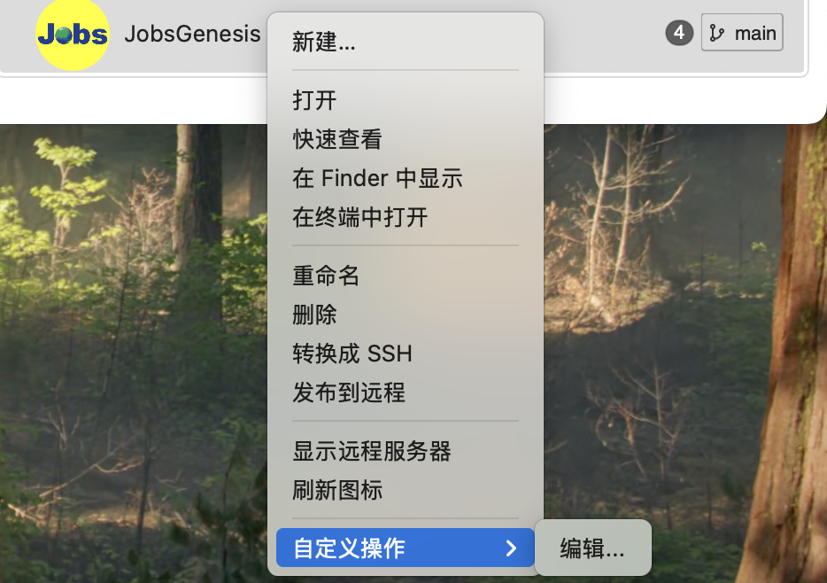
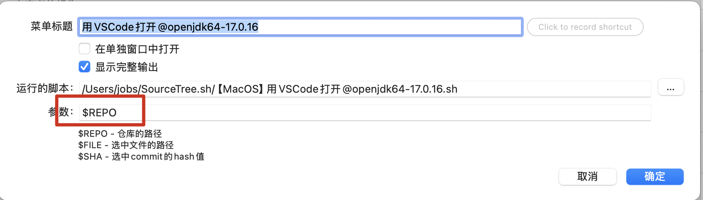

# 配置 [**Sourcetree**](https://www.sourcetreeapp.com/) 自定义脚本


<!-- jobs-toc:start -->
<!-- jobs-toc:source {"v":2,"token":"[toc]"} -->
<details>
<summary>📚 目录（点击展开 / 收起）</summary>

- [🔥 前言](#jobs-toc-heading-1)
- [一、菜单安装](#jobs-toc-heading-2)
- [二、运行策略](#jobs-toc-heading-3)
- [三、脚本索引](#jobs-toc-heading-4)
- [四、维护和验证](#jobs-toc-heading-5)
- [五、日志和常见问题](#jobs-toc-heading-6)
- [六、目录结构](#repository-layout)
- [七、脚本执行流程](#script-workflows)
  - [【MacOS@SourceTree】⏬只拉取远程代码.command](#jobs-toc-heading-9)
  - [【MacOS@SourceTree】⏬双击下载SourceTree效率脚本.command](#jobs-toc-heading-10)
  - [【MacOS@SourceTree】♻️修复Flutter项目中文路径.command](#jobs-toc-heading-11)
  - [【MacOS@SourceTree】♻️双击Git（识别子Git） 提交回退.command](#jobs-toc-heading-12)
  - [【MacOS@SourceTree】⚙️收集当前Flutter工程的依赖.command](#jobs-toc-heading-13)
  - [【MacOS@SourceTree】⚙️运行授权.command](#jobs-toc-heading-14)
  - [【MacOS@SourceTree】同步edgetunnel代码后手动升级.command](#jobs-toc-heading-15)
  - [【MacOS@SourceTree】用Android Studio打开.command](#jobs-toc-heading-16)
  - [【MacOS@SourceTree】用Android Studio打开openjdk64-17.0.16.command](#jobs-toc-heading-17)
  - [【MacOS@SourceTree】用Trae打开@openjdk64-17.0.16.command](#jobs-toc-heading-18)
  - [【MacOS@SourceTree】用Trea打开.command](#jobs-toc-heading-19)
  - [【MacOS@SourceTree】用VSCode打开.command](#jobs-toc-heading-20)
  - [【MacOS@SourceTree】用VSCode打开@openjdk64-17.0.16.command](#jobs-toc-heading-21)
  - [【MacOS@SourceTree】用终端打开.command](#jobs-toc-heading-22)
  - [【MacOS@SourceTree】获取目标绝对地址.command](#jobs-toc-heading-23)
  - [【MacOS@SourceTree】（只打开当前目录）用Xcode打开.command](#jobs-toc-heading-24)
  - [【MacOS@SourceTree】（递归目录寻找工程@不适用于多工程项目）用Xcode打开.command](#jobs-toc-heading-25)
  - [【MacOS@SourceTree】🌐获取远程仓库地址.command](#jobs-toc-heading-26)
  - [【MacOS@SourceTree】🌍打开远程仓库地址.command](#jobs-toc-heading-27)
  - [【MacOS@SourceTree】🐦Flutter自动化生产代码.command](#jobs-toc-heading-28)
  - [【MacOS@SourceTree】🐦Flutter重新拉取第三方依赖.command](#jobs-toc-heading-29)
  - [【MacOS@SourceTree】🐦Flutter项目体检.command](#jobs-toc-heading-30)
  - [【MacOS@SourceTree】🐦打开：运行Flutter项目.command](#jobs-toc-heading-31)
  - [【MacOS@SourceTree】📘用Typora打开蓝皮书.command](#jobs-toc-heading-32)
  - [【MacOS@SourceTree】📥修复Git无法Commit.command](#jobs-toc-heading-33)
  - [【MacOS@SourceTree】📥修复Git无法Fetch.command](#jobs-toc-heading-34)
  - [【MacOS@SourceTree】📦双击打包Flutter.android.command](#jobs-toc-heading-35)
  - [【MacOS@SourceTree】📦双击打包Flutter.iOS.command](#jobs-toc-heading-36)
  - [【MacOS@SourceTree】📦双击打包Flutter.ohos.command](#jobs-toc-heading-37)
  - [【MacOS@SourceTree】📦双击自动生成ipa文件.command](#jobs-toc-heading-38)
  - [【MacOS@SourceTree】🚀逐层空白提交并Push.command](#jobs-toc-heading-39)
  - [【MacOS@SourceTree】🪄配置并运行Magic Resume.command](#jobs-toc-heading-40)
  - [【MacOS@SourceTree】🫘在Sourcetree中运行Pod Install.command](#jobs-toc-heading-41)
  - [【MacOS@SourceTree】🫘打开终端运行Pod Install.command](#jobs-toc-heading-42)
  - [【MacOS】安装SourceTree自定义菜单.command](#jobs-toc-heading-43)

</details>
<!-- jobs-toc:end -->

---

## <span id="jobs-toc-heading-1" data-jobs-toc="v2">🔥 <font id=前言>前言</font></span><!-- jobs-toc:heading-end -->

脚本库包含 35 个系统 `/bin/zsh` 入口，每个脚本包有同名 `.command` 和独立 `README.md`（位于 `MacOS/`；按各包独立主脚本计数，不含内部工具；依据当前磁盘目录，2026-10-28）。源码、静态说明和运行时内置自述分别维护；运行时不读取 README。

运行态位于当前用户家目录的 `SourceTree.command`，备份态为 JobsGenesis 下的同名 Git 工作树。维护时保留两侧已有改动，修改完成后按相同相对路径同步脚本、README、资源及菜单配置；Git 元数据和系统生成文件不互相覆盖。

[**Android**](https://developer.android.com) 打包生成 APK / AAB；[**HarmonyOS**](https://developer.huawei.com/consumer/cn/harmonyos/) 应用安装包使用 HAP、发布包使用 APP，构建工具链与签名配置不同。[鸿蒙 Flutter 打包入口](./MacOS/【MacOS@SourceTree】📦双击打包Flutter.ohos.command/README.md) 只适用于已含 `ohos/` 的适配工程，并要求同时支持 `flutter build hap` 与 `flutter build app` 的 [Flutter 适配 SDK](https://gitcode.com/CPF-Flutter/flutter_flutter)；不会把 Android APK 转成 HAP，也不自动迁移工程。

平台目录分为 `MacOS/` 与 `WindowsOS/`：35 个 `.command` 包及资源在 `MacOS/`，Windows 提供 28 个动作和一个菜单安装入口（按平台动作清单与主入口计数，2026-10-28）。Git 元数据与 Markdown 过滤器继续位于仓库根；[Windows 功能对照、排除清单与运行说明](./WindowsOS/README.md)。

```text
SourceTree.command/
├── MacOS/       macOS 脚本包、菜单安装器与图片
├── WindowsOS/   .cmd / .ps1、菜单安装器与随包模块
└── README.md    双端总览与原脚本说明
```

原名称 `🐦打开:运行Flutter项目` 中 ASCII 冒号已改为全角 `：`，使整个仓库可在 Windows 检出；动作标题保留用户设置，迁移脚本目标。

## <span id="jobs-toc-heading-2" data-jobs-toc="v2">一、菜单安装 <a href="#前言" style="font-size:17px; color:green;"><b>🔼</b></a> <a href="#🔚" style="font-size:17px; color:green;"><b>🔽</b></a></span><!-- jobs-toc:heading-end -->

从本 README 所在目录执行：

```shell
/bin/zsh './MacOS/【MacOS】安装SourceTree自定义菜单.command/【MacOS】安装SourceTree自定义菜单.command'
```

安装器先确认库发送目标，再选择菜单安装或配置回收。已有目标库回车保留，输入 `YES` 才备份替换。菜单按脚本路径合并并保留自定义显示标题、快捷键和显示设置，覆盖前生成可恢复备份；正在运行的 Sourcetree 正常退出、保存配置后再写入并重新打开，不强制结束。

macOS 菜单按“打开 → Git 与地址 → 修复 → Flutter 维护 → CocoaPods → 打包 → 工具”连续归类，获取远程仓库地址与获取目标绝对地址相邻，三项修复相邻，每个标题以 emoji 开头，体检标题末尾不带句点。鸿蒙显示为 `📦打包生成HAP+APP文件（Flutter.ohos）`，与 Android / iOS 打包相邻；重新安装仍保持此顺序，额外动作按原相对顺序放在末尾。完整顺序见[安装器说明](./MacOS/【MacOS】安装SourceTree自定义菜单.command/README.md)。

菜单动作目标默认使用家目录运行副本；指定其它发送目录时使用该目标库，仓库动作参数为 `$REPO`，不是把多个路径拼接成一个参数。所有动作目标须存在、可执行且唯一。菜单安装、下载配置、运行授权三个入口保留为独立脚本，不挂成仓库菜单；模板登记其余 32 个仓库动作。

详细步骤、依赖与风险见 [安装器 README](./MacOS/【MacOS】安装SourceTree自定义菜单.command/README.md)。

## <span id="jobs-toc-heading-3" data-jobs-toc="v2">二、运行策略 <a href="#前言" style="font-size:17px; color:green;"><b>🔼</b></a> <a href="#🔚" style="font-size:17px; color:green;"><b>🔽</b></a></span><!-- jobs-toc:heading-end -->

- 终端运行：先展示固定内置自述，回车继续、`Ctrl+C` 取消；确认前不写日志、不执行项目业务。没有可交互输入且未明确识别 Sourcetree 时退出。
- Sourcetree 动作：根据明确环境或父进程链识别，无交互连续执行；相对脚本路径、非 TTY 或 `TERM=dumb` 单独不能作为身份依据。
- Sourcetree、非 TTY、`NO_COLOR` 使用纯文本输出；完整终端自述标题红色加粗、正文蓝色常规。业务错误不会被最后的成功输出掩盖。
- 递归动作跳过 Git、依赖、缓存与生成目录；具体范围及所有权过滤由各包 README 说明，明确目标错误时不回退到其它项目。
- 普通更新或升级回车跳过，输入任意字符后回车执行；危险替换或 hard 回退要求 `YES`。只拉取远程代码、逐层 Push 与终端 Pod Install 会转交独立终端，以对应入口确认和结果为准。
- 获取与打开远程地址共用选择逻辑：所有 remote 的 fetch / push 地址去重后，单地址直接执行，多个地址进独立终端用 fzf 单选。macOS 在缺少 fzf 时沿 Homebrew 依赖链检查，Windows 沿 WinGet 分支检查；安装 / 修复需终端确认并复检，失败停止，健康环境不安装。
- 开发工具、Java 17 和项目 SDK 先检查实际可用性。打开类动作复用现有工具，不为打开项目自动安装依赖或清理全局缓存；工具缺失时提供明确排查入口。

## <span id="jobs-toc-heading-4" data-jobs-toc="v2">三、脚本索引 <a href="#前言" style="font-size:17px; color:green;"><b>🔼</b></a> <a href="#🔚" style="font-size:17px; color:green;"><b>🔽</b></a></span><!-- jobs-toc:heading-end -->

| 脚本包 | 说明 |
| --- | --- |
| `⏬只拉取远程代码` | [README](./MacOS/【MacOS@SourceTree】⏬只拉取远程代码.command/README.md) |
| `⏬双击下载SourceTree效率脚本` | [README](<./MacOS/【MacOS%40SourceTree】⏬双击下载SourceTree效率脚本.command/README.md>) |
| `♻️修复Flutter项目中文路径` | [README](<./MacOS/【MacOS%40SourceTree】♻️修复Flutter项目中文路径.command/README.md>) |
| `♻️双击Git（识别子Git） 提交回退` | [README](<./MacOS/【MacOS%40SourceTree】♻️双击Git（识别子Git） 提交回退.command/README.md>) |
| `⚙️收集当前Flutter工程的依赖` | [README](<./MacOS/【MacOS%40SourceTree】⚙️收集当前Flutter工程的依赖.command/README.md>) |
| `⚙️运行授权` | [README](<./MacOS/【MacOS%40SourceTree】⚙️运行授权.command/README.md>) |
| `同步edgetunnel代码后手动升级` | [README](<./MacOS/【MacOS%40SourceTree】同步edgetunnel代码后手动升级.command/README.md>) |
| `用Android Studio打开` | [README](<./MacOS/【MacOS%40SourceTree】用Android Studio打开.command/README.md>) |
| `用Android Studio打开openjdk64-17.0.16` | [README](<./MacOS/【MacOS%40SourceTree】用Android Studio打开openjdk64-17.0.16.command/README.md>) |
| `用Trae打开@openjdk64-17.0.16` | [README](<./MacOS/【MacOS%40SourceTree】用Trae打开%40openjdk64-17.0.16.command/README.md>) |
| `用Trea打开` | [README](<./MacOS/【MacOS%40SourceTree】用Trea打开.command/README.md>) |
| `用VSCode打开` | [README](<./MacOS/【MacOS%40SourceTree】用VSCode打开.command/README.md>) |
| `用VSCode打开@openjdk64-17.0.16` | [README](<./MacOS/【MacOS%40SourceTree】用VSCode打开%40openjdk64-17.0.16.command/README.md>) |
| `用终端打开` | [README](<./MacOS/【MacOS%40SourceTree】用终端打开.command/README.md>) |
| `获取目标绝对地址` | [README](<./MacOS/【MacOS%40SourceTree】获取目标绝对地址.command/README.md>) |
| `（只打开当前目录）用Xcode打开` | [README](<./MacOS/【MacOS%40SourceTree】（只打开当前目录）用Xcode打开.command/README.md>) |
| `（递归目录寻找工程@不适用于多工程项目）用Xcode打开` | [README](<./MacOS/【MacOS%40SourceTree】（递归目录寻找工程%40不适用于多工程项目）用Xcode打开.command/README.md>) |
| `🌐获取远程仓库地址` | [README](<./MacOS/【MacOS%40SourceTree】🌐获取远程仓库地址.command/README.md>) |
| `🌍打开远程仓库地址` | [README](./MacOS/【MacOS@SourceTree】🌍打开远程仓库地址.command/README.md) |
| `🐦Flutter自动化生产代码` | [README](<./MacOS/【MacOS%40SourceTree】🐦Flutter自动化生产代码.command/README.md>) |
| `🐦Flutter重新拉取第三方依赖` | [README](<./MacOS/【MacOS%40SourceTree】🐦Flutter重新拉取第三方依赖.command/README.md>) |
| `🐦Flutter项目体检` | [README](<./MacOS/【MacOS%40SourceTree】🐦Flutter项目体检.command/README.md>) |
| `🐦打开:运行Flutter项目` | [README](<./MacOS/【MacOS%40SourceTree】🐦打开：运行Flutter项目.command/README.md>) |
| `📘用Typora打开蓝皮书` | [README](<./MacOS/【MacOS%40SourceTree】📘用Typora打开蓝皮书.command/README.md>) |
| `📥修复Git无法Commit` | [README](<./MacOS/【MacOS%40SourceTree】📥修复Git无法Commit.command/README.md>) |
| `📥修复Git无法Fetch` | [README](<./MacOS/【MacOS%40SourceTree】📥修复Git无法Fetch.command/README.md>) |
| `📦双击打包Flutter.android` | [README](<./MacOS/【MacOS%40SourceTree】📦双击打包Flutter.android.command/README.md>) |
| `📦双击打包Flutter.iOS` | [README](<./MacOS/【MacOS%40SourceTree】📦双击打包Flutter.iOS.command/README.md>) |
| `📦打包生成HAP+APP文件（Flutter.ohos）` | [README](./MacOS/【MacOS@SourceTree】📦双击打包Flutter.ohos.command/README.md) |
| `📦双击自动生成ipa文件` | [README](<./MacOS/【MacOS%40SourceTree】📦双击自动生成ipa文件.command/README.md>) |
| `🚀逐层空白提交并Push` | [README](<./MacOS/【MacOS%40SourceTree】🚀逐层空白提交并Push.command/README.md>) |
| `🪄配置并运行Magic Resume` | [README](<./MacOS/【MacOS%40SourceTree】🪄配置并运行Magic Resume.command/README.md>) |
| `🫘在Sourcetree中运行Pod Install` | [README](<./MacOS/【MacOS%40SourceTree】🫘在Sourcetree中运行Pod Install.command/README.md>) |
| `🫘打开终端运行Pod Install` | [README](<./MacOS/【MacOS%40SourceTree】🫘打开终端运行Pod Install.command/README.md>) |
| `安装SourceTree自定义菜单` | [README](<./MacOS/【MacOS】安装SourceTree自定义菜单.command/README.md>) |

## <span id="jobs-toc-heading-5" data-jobs-toc="v2">四、维护和验证 <a href="#前言" style="font-size:17px; color:green;"><b>🔼</b></a> <a href="#🔚" style="font-size:17px; color:green;"><b>🔽</b></a></span><!-- jobs-toc:heading-end -->

回归覆盖入口确认、Sourcetree 纯文本、特殊字符路径、工具链健康、参数与默认值、命令失败传播、目录安全、产物选择和文档对账。Git 采用临时仓库复现，构建、工具安装和外部应用启动采用假命令；不把真实项目构建、提交或推送作为回归测试。

远程地址动作的隔离验证入口见 [macOS 测试说明](./MacOS/Tests/README.md)；Windows 测试与平台限制见 [Windows 说明](./WindowsOS/README.md)。

两态均执行所有入口的 `zsh -n`；按内容哈希及执行权限核对脚本、README、资源和 `actions.plist`，并检查菜单解档、目标唯一、`$REPO` 参数和实际可执行路径。运行态的 Git 元数据、备份态的子模块绑定以及 `.DS_Store` 保持各自独立。

验证完成的代码不代表全部外部环境验收：开发者签名、真实 Flutter/Xcode 构建、包管理器安装、Cloudflare 部署、具体 IDE/模拟器启动仍需在对应项目环境使用时确认结果。各 README 分别说明真实能力与未执行边界。

## <span id="jobs-toc-heading-6" data-jobs-toc="v2">五、日志和常见问题 <a href="#前言" style="font-size:17px; color:green;"><b>🔼</b></a> <a href="#🔚" style="font-size:17px; color:green;"><b>🔽</b></a></span><!-- jobs-toc:heading-end -->

各包 README 列出实际日志名称，默认位于系统临时目录。终端启动器的成功仅表示已提交启动；最终业务退出码和详细日志在子入口或新终端中。

- 菜单提示路径不可访问：重新运行安装器，检查动作是否指向当前运行副本且有执行位。
- Terminal/Sourcetree 缺工具：先检查各脚本声明的 PATH、SDK、版本管理器及工具健康；不依赖图形应用继承外部终端全部设置。
- 多项目歧义：显式传入目标工程或工作区，不依赖扫描顺序选第一个。
- 执行失败：保留现场，按非零退出码和日志中的目标排查；下载或替换失败使用覆盖前备份恢复。

手工配置的界面位置可参考以下图，最终字段以安装器生成配置为准：





## 六、<span id="repository-layout">目录结构</span> <a href="#前言" style="font-size:17px; color:green;"><b>🔼</b></a> <a href="#🔚" style="font-size:17px; color:green;"><b>🔽</b></a>

下面列出 `MacOS/` 内的脚本包；`WindowsOS/` 入口及功能差异见前述双端总览。包内主脚本由下方完整名称直接进入。

```text
SourceTree.command/MacOS/
├── assets/
├── icon.png
├── 【MacOS@SourceTree】⏬只拉取远程代码.command/  # 1 个入口
├── 【MacOS@SourceTree】⏬双击下载SourceTree效率脚本.command/  # 1 个入口
├── 【MacOS@SourceTree】♻️修复Flutter项目中文路径.command/  # 1 个入口
├── 【MacOS@SourceTree】♻️双击Git（识别子Git） 提交回退.command/  # 1 个入口
├── 【MacOS@SourceTree】⚙️收集当前Flutter工程的依赖.command/  # 1 个入口
├── 【MacOS@SourceTree】⚙️运行授权.command/  # 1 个入口
├── 【MacOS@SourceTree】同步edgetunnel代码后手动升级.command/  # 1 个入口
├── 【MacOS@SourceTree】用Android Studio打开.command/  # 1 个入口
├── 【MacOS@SourceTree】用Android Studio打开openjdk64-17.0.16.command/  # 1 个入口
├── 【MacOS@SourceTree】用Trae打开@openjdk64-17.0.16.command/  # 1 个入口
├── 【MacOS@SourceTree】用Trea打开.command/  # 1 个入口
├── 【MacOS@SourceTree】用VSCode打开.command/  # 1 个入口
├── 【MacOS@SourceTree】用VSCode打开@openjdk64-17.0.16.command/  # 1 个入口
├── 【MacOS@SourceTree】用终端打开.command/  # 1 个入口
├── 【MacOS@SourceTree】获取目标绝对地址.command/  # 1 个入口
├── 【MacOS@SourceTree】（只打开当前目录）用Xcode打开.command/  # 1 个入口
├── 【MacOS@SourceTree】（递归目录寻找工程@不适用于多工程项目）用Xcode打开.command/  # 1 个入口
├── 【MacOS@SourceTree】🌐获取远程仓库地址.command/  # 1 个入口
├── 【MacOS@SourceTree】🌍打开远程仓库地址.command/  # 1 个入口
├── 【MacOS@SourceTree】🐦Flutter自动化生产代码.command/  # 1 个入口
├── 【MacOS@SourceTree】🐦Flutter重新拉取第三方依赖.command/  # 1 个入口
├── 【MacOS@SourceTree】🐦Flutter项目体检.command/  # 1 个入口
├── 【MacOS@SourceTree】🐦打开：运行Flutter项目.command/  # 1 个入口
├── 【MacOS@SourceTree】📘用Typora打开蓝皮书.command/  # 1 个入口
├── 【MacOS@SourceTree】📥修复Git无法Commit.command/  # 1 个入口
├── 【MacOS@SourceTree】📥修复Git无法Fetch.command/  # 1 个入口
├── 【MacOS@SourceTree】📦双击打包Flutter.android.command/  # 1 个入口
├── 【MacOS@SourceTree】📦双击打包Flutter.iOS.command/  # 1 个入口
├── 【MacOS@SourceTree】📦双击打包Flutter.ohos.command/  # 1 个入口
├── 【MacOS@SourceTree】📦双击自动生成ipa文件.command/  # 1 个入口
├── 【MacOS@SourceTree】🚀逐层空白提交并Push.command/  # 1 个入口
├── 【MacOS@SourceTree】🪄配置并运行Magic Resume.command/  # 1 个入口
├── 【MacOS@SourceTree】🫘在Sourcetree中运行Pod Install.command/  # 1 个入口
├── 【MacOS@SourceTree】🫘打开终端运行Pod Install.command/  # 1 个入口
└── 【MacOS】安装SourceTree自定义菜单.command/  # 1 个入口
```

## 七、<span id="script-workflows">脚本执行流程</span> <a href="#前言" style="font-size:17px; color:green;"><b>🔼</b></a> <a href="#🔚" style="font-size:17px; color:green;"><b>🔽</b></a>

macOS 侧共有 35 个用户入口（位于 `MacOS/`；按各包独立主脚本计数，依据当前磁盘目录，2026-10-28）。这里只列本仓维护的主入口；独立子 Git、测试、函数库及打包资源模板不作为用户运行入口。步骤来自静态源码与配套说明，不在真实业务仓执行安装、清理、构建或 Git 写操作。

### <span id="jobs-toc-heading-9" data-jobs-toc="v2">[【MacOS@SourceTree】⏬只拉取远程代码.command](./MacOS/【MacOS@SourceTree】⏬只拉取远程代码.command/【MacOS@SourceTree】⏬只拉取远程代码.command)</span><!-- jobs-toc:heading-end -->

> **目的：** 从独立终端同步只能拉取的仓库，并向下检出父仓锁定的子模块版本，不提交、不推送。

- SourceTree 只负责打开 Terminal，终端显示自述并等待回车。
- 确认当前分支的明确远程上游，显示来源，成功 fetch 后固定目标提交。
- 检查工作区、暂存内容、未跟踪文件及本地独有提交；有风险时红字列明，精确输入 `YES` 才舍弃并同步。
- 逐层预取父仓 gitlink 指定的子提交；纯子仓 HEAD 漂移自动对齐，不追踪各子仓分支最新。
- 忽略文件保留；子仓源码、暂存指针、未完成操作、独有游离提交或有损路径变更停止，父仓 `YES` 不授权丢弃子仓内容。
- 子提交在所选来源缺失时，显示具体仓库、来源和 SHA，要求发布端补齐；不退回旧版本，不生成待 push 的本地提交。
- 逐仓核验最终提交与工作区，输出来源、日志和退出码；不向更高父仓同步。

### <span id="jobs-toc-heading-10" data-jobs-toc="v2">[【MacOS@SourceTree】⏬双击下载SourceTree效率脚本.command](<./MacOS/【MacOS@SourceTree】⏬双击下载SourceTree效率脚本.command/【MacOS@SourceTree】⏬双击下载SourceTree效率脚本.command>)</span><!-- jobs-toc:heading-end -->

> **目的：** 先校验下载内容，再安全替换本机脚本库。

- 检查系统 Git 与目标运行目录，先确认是否允许替换。
  - 如果运行目录已存在，终端须输入 `YES`；Sourcetree 无交互模式停止，不覆盖已有库。
- 从预设仓库下载到暂存目录。
- 检查脚本语法和包结构，给入口补执行权限。
- 完整备份旧目录后替换并输出结果。

### <span id="jobs-toc-heading-11" data-jobs-toc="v2">[【MacOS@SourceTree】♻️修复Flutter项目中文路径.command](<./MacOS/【MacOS@SourceTree】♻️修复Flutter项目中文路径.command/【MacOS@SourceTree】♻️修复Flutter项目中文路径.command>)</span><!-- jobs-toc:heading-end -->

> **目的：** 解码自有 Dart package 指令中的 URI 编码路径。

- 定位工程并限定可修改的自有 Dart 文件。
- 逐项检测编码路径，备份原文件后写入解码内容。
- 汇总修复数量，跳过生成和第三方文件。

### <span id="jobs-toc-heading-12" data-jobs-toc="v2">[【MacOS@SourceTree】♻️双击Git（识别子Git） 提交回退.command](<./MacOS/【MacOS@SourceTree】♻️双击Git（识别子Git） 提交回退.command/【MacOS@SourceTree】♻️双击Git（识别子Git） 提交回退.command>)</span><!-- jobs-toc:heading-end -->

> **目的：** 在本地撤回选定远端快照或历史提交之后的提交，保留内容供重新审阅。

- 定位仓库，检查冲突、锁与未完成 Git 操作。
- 选择回退目标与模式。
  - Sourcetree 各远端快照不同时转交终端，明确选择线路或历史提交后 soft 回退；hard 只在直接终端运行并输入 YES 后允许。
- 按实际净差异报告待提交内容；空提交可能没有文件变化。不 Fetch、不提交、不推送，也不向上回退父仓或递归重置子仓。

### <span id="jobs-toc-heading-13" data-jobs-toc="v2">[【MacOS@SourceTree】⚙️收集当前Flutter工程的依赖.command](<./MacOS/【MacOS@SourceTree】⚙️收集当前Flutter工程的依赖.command/【MacOS@SourceTree】⚙️收集当前Flutter工程的依赖.command>)</span><!-- jobs-toc:heading-end -->

> **目的：** 归档已解析的 Flutter / 原生依赖和工程清单。

- 定位项目并检查已有依赖解析；默认不执行 pub get。
- 选择全量或终端多选范围，复制实际包源码与工程依赖清单。
- 写入可追溯说明并生成桌面 Zip，默认不改工程依赖。
  - 显式启用 `flutter pub get` 时会联网，并可能更新工程依赖解析文件。

### <span id="jobs-toc-heading-14" data-jobs-toc="v2">[【MacOS@SourceTree】⚙️运行授权.command](<./MacOS/【MacOS@SourceTree】⚙️运行授权.command/【MacOS@SourceTree】⚙️运行授权.command>)</span><!-- jobs-toc:heading-end -->

> **目的：** 为明确选定的 .command 文件添加用户执行权限并移除其隔离属性。

- 解析一个或多个目标，默认只扫描目标第一层。
- 核对 .command 普通文件，按显式递归参数扩展扫描。
- 逐项修改执行权限、移除隔离属性并输出成功 / 失败统计；文件正文保留。

### <span id="jobs-toc-heading-15" data-jobs-toc="v2">[【MacOS@SourceTree】同步edgetunnel代码后手动升级.command](<./MacOS/【MacOS@SourceTree】同步edgetunnel代码后手动升级.command/【MacOS@SourceTree】同步edgetunnel代码后手动升级.command>)</span><!-- jobs-toc:heading-end -->

> **目的：** 为已同步的 edgetunnel 仓库配置并部署 Worker。

- 校验仓库身份、Node / 包管理器和 Wrangler。
- 检查 Cloudflare 登录、部署配置与 KV 绑定。
- 安装工程依赖并执行部署，显示结果；本入口不负责 Git 拉取或提交。

### <span id="jobs-toc-heading-16" data-jobs-toc="v2">[【MacOS@SourceTree】用Android Studio打开.command](<./MacOS/【MacOS@SourceTree】用Android Studio打开.command/【MacOS@SourceTree】用Android Studio打开.command>)</span><!-- jobs-toc:heading-end -->

> **目的：** 用 Android Studio 打开明确选定的项目或文档。

- 解析并校验目录或文件目标。
- 先尝试健康命令行入口，再查找本机应用。
- 调用应用打开目标并保留真实退出状态。
  - 如果工具不存在，打开官方下载页并报告需要安装，不把浏览器打开当成工程已打开。

### <span id="jobs-toc-heading-17" data-jobs-toc="v2">[【MacOS@SourceTree】用Android Studio打开openjdk64-17.0.16.command](<./MacOS/【MacOS@SourceTree】用Android Studio打开openjdk64-17.0.16.command/【MacOS@SourceTree】用Android Studio打开openjdk64-17.0.16.command>)</span><!-- jobs-toc:heading-end -->

> **目的：** 用 Android Studio 打开明确选定的项目或文档。

- 解析并校验目录或文件目标。
- 发现并验证健康 Java 17，在本次启动进程中设置 Java 环境。
  - 存在健康的 jenv 映射时，还会保存项目 `.java-version`。
- 先尝试健康命令行入口，再查找本机应用。
- 调用应用打开目标并保留真实退出状态。
  - 如果工具不存在，打开官方下载页并报告需要安装，不把浏览器打开当成工程已打开。

### <span id="jobs-toc-heading-18" data-jobs-toc="v2">[【MacOS@SourceTree】用Trae打开@openjdk64-17.0.16.command](<./MacOS/【MacOS@SourceTree】用Trae打开@openjdk64-17.0.16.command/【MacOS@SourceTree】用Trae打开@openjdk64-17.0.16.command>)</span><!-- jobs-toc:heading-end -->

> **目的：** 用 Trae 打开明确选定的项目或文档。

- 解析并校验目录或文件目标。
- 发现并验证健康 Java 17，在本次启动进程中设置 Java 环境。
  - 存在健康的 jenv 映射时，还会保存项目 `.java-version`。
- 先尝试健康命令行入口，再查找本机应用。
- 调用应用打开目标并保留真实退出状态。
  - 如果工具不存在，打开官方下载页并报告需要安装，不把浏览器打开当成工程已打开。

### <span id="jobs-toc-heading-19" data-jobs-toc="v2">[【MacOS@SourceTree】用Trea打开.command](<./MacOS/【MacOS@SourceTree】用Trea打开.command/【MacOS@SourceTree】用Trea打开.command>)</span><!-- jobs-toc:heading-end -->

> **目的：** 用 Trae 打开明确选定的项目或文档。

- 解析并校验目录或文件目标。
- 先尝试健康命令行入口，再查找本机应用。
- 调用应用打开目标并保留真实退出状态。
  - 如果工具不存在，打开官方下载页并报告需要安装，不把浏览器打开当成工程已打开。

### <span id="jobs-toc-heading-20" data-jobs-toc="v2">[【MacOS@SourceTree】用VSCode打开.command](<./MacOS/【MacOS@SourceTree】用VSCode打开.command/【MacOS@SourceTree】用VSCode打开.command>)</span><!-- jobs-toc:heading-end -->

> **目的：** 用 VS Code 打开明确选定的项目或文档。

- 解析并校验目录或文件目标。
- 先尝试健康命令行入口，再查找本机应用。
- 调用应用打开目标并保留真实退出状态。
  - 如果工具不存在，打开官方下载页并报告需要安装，不把浏览器打开当成工程已打开。

### <span id="jobs-toc-heading-21" data-jobs-toc="v2">[【MacOS@SourceTree】用VSCode打开@openjdk64-17.0.16.command](<./MacOS/【MacOS@SourceTree】用VSCode打开@openjdk64-17.0.16.command/【MacOS@SourceTree】用VSCode打开@openjdk64-17.0.16.command>)</span><!-- jobs-toc:heading-end -->

> **目的：** 用 VS Code 打开明确选定的项目或文档。

- 解析并校验目录或文件目标。
- 发现并验证健康 Java 17，在本次启动进程中设置 Java 环境。
  - 存在健康的 jenv 映射时，还会保存项目 `.java-version`。
- 先尝试健康命令行入口，再查找本机应用。
- 调用应用打开目标并保留真实退出状态。
  - 如果工具不存在，打开官方下载页并报告需要安装，不把浏览器打开当成工程已打开。

### <span id="jobs-toc-heading-22" data-jobs-toc="v2">[【MacOS@SourceTree】用终端打开.command](<./MacOS/【MacOS@SourceTree】用终端打开.command/【MacOS@SourceTree】用终端打开.command>)</span><!-- jobs-toc:heading-end -->

> **目的：** 打开 Terminal 并进入指定仓库或文件所在目录。

- 解析仓库参数，文件目标转换为父目录。
- 校验目录并构造安全的 cd 命令。
- 打开系统终端执行该命令。

### <span id="jobs-toc-heading-23" data-jobs-toc="v2">[【MacOS@SourceTree】获取目标绝对地址.command](<./MacOS/【MacOS@SourceTree】获取目标绝对地址.command/【MacOS@SourceTree】获取目标绝对地址.command>)</span><!-- jobs-toc:heading-end -->

> **目的：** 取得所选路径的物理绝对地址并复制。

- 解析仓库、文件或目录参数，核对目标或其父目录。
  - 目标尚不存在但父目录有效时，仍可给出绝对地址；缺少 `pbcopy` 时只打印结果。
- 将路径解析为物理绝对地址。
- 在输出窗口显示并复制到剪贴板。

### <span id="jobs-toc-heading-24" data-jobs-toc="v2">[【MacOS@SourceTree】（只打开当前目录）用Xcode打开.command](<./MacOS/【MacOS@SourceTree】（只打开当前目录）用Xcode打开.command/【MacOS@SourceTree】（只打开当前目录）用Xcode打开.command>)</span><!-- jobs-toc:heading-end -->

> **目的：** 用 Xcode 打开当前目录的明确工程或工作区。

- 解析仓库参数，检查顶层 .xcworkspace / .xcodeproj。
- 选择唯一或明确指定的工程；多候选时要求明确目标。
- 调用 Xcode 打开，不自动执行 Pod 安装。

### <span id="jobs-toc-heading-25" data-jobs-toc="v2">[【MacOS@SourceTree】（递归目录寻找工程@不适用于多工程项目）用Xcode打开.command](<./MacOS/【MacOS@SourceTree】（递归目录寻找工程@不适用于多工程项目）用Xcode打开.command/【MacOS@SourceTree】（递归目录寻找工程@不适用于多工程项目）用Xcode打开.command>)</span><!-- jobs-toc:heading-end -->

> **目的：** 递归定位明确的 Xcode 工程并打开。

- 解析目标目录，跳过依赖和生成目录递归查找工程。
- 核对候选；存在歧义时停止，使用明确工程路径重试。
- 用 Xcode 打开所选工作区或工程，不自动安装依赖。

### <span id="jobs-toc-heading-26" data-jobs-toc="v2">[【MacOS@SourceTree】🌐获取远程仓库地址.command](<./MacOS/【MacOS@SourceTree】🌐获取远程仓库地址.command/【MacOS@SourceTree】🌐获取远程仓库地址.command>)</span><!-- jobs-toc:heading-end -->

> **目的：** 获取当前 Git 仓库中选定的远程地址并复制。

- 解析目标仓库，读取全部 remote 的所有 fetch / push URL，按原始地址去重。
- 唯一地址直接复制；多个地址在独立 Terminal 中使用 [**fzf**](https://github.com/junegunn/fzf) 单选，回车选择、Esc 取消，空选或失败不复制。
- 仅多地址时检查并按确认修复选择器依赖；选择列表和日志脱敏，剪贴板保留原始地址。
- 输出远端来源、选中地址与日志；不读取远端网络内容、不修改仓库。

### <span id="jobs-toc-heading-27" data-jobs-toc="v2">[【MacOS@SourceTree】🌍打开远程仓库地址.command](<./MacOS/【MacOS@SourceTree】🌍打开远程仓库地址.command/【MacOS@SourceTree】🌍打开远程仓库地址.command>)</span><!-- jobs-toc:heading-end -->

> **目的：** 在默认浏览器打开当前 Git 仓库中选定的远程仓库网页。

- 与获取动作共用全部 remote、fetch / push URL 与去重选择规则。
- 唯一地址直接打开；多个地址转交独立 Terminal，通过 fzf 选择后打开，取消不启动浏览器。
- 将可识别的 SSH / Git 克隆地址转换为 HTTPS 网页地址，去除 `.git` 尾缀与凭据；本地路径、危险协议及不能可靠映射的端口停止并提示明确 HTTPS 地址。
- 只打开选中网页，不执行 fetch、pull、push 或修改 Git 配置。

### <span id="jobs-toc-heading-28" data-jobs-toc="v2">[【MacOS@SourceTree】🐦Flutter自动化生产代码.command](<./MacOS/【MacOS@SourceTree】🐦Flutter自动化生产代码.command/【MacOS@SourceTree】🐦Flutter自动化生产代码.command>)</span><!-- jobs-toc:heading-end -->

> **目的：** 按工程实际启用的生成器生成代码与资源。

- 定位真实 Flutter 项目及其 SDK，依据依赖声明与生成器配置列出计划；`--check` 只预览，不调用 SDK、不写项目。
- 默认执行 `pub get`，再生成项目明确配置的代码、图标、启动页、国际化或绑定文件；任一步失败停止。
  - 默认不清缓存、不传强制删除冲突参数；生成器仍会改写其管理的产物。显式启用清理或删除冲突输出时，须在终端输入 `YES`。
- 报告结果及日志；持续 watch 仅限终端，已声明 FVM 的工程不静默切换到全局 SDK。

### <span id="jobs-toc-heading-29" data-jobs-toc="v2">[【MacOS@SourceTree】🐦Flutter重新拉取第三方依赖.command](<./MacOS/【MacOS@SourceTree】🐦Flutter重新拉取第三方依赖.command/【MacOS@SourceTree】🐦Flutter重新拉取第三方依赖.command>)</span><!-- jobs-toc:heading-end -->

> **目的：** 清理当前 Flutter 工程并重建依赖解析。

- 定位项目，复用其全局或 FVM SDK。
- 顺序执行 flutter clean 与 flutter pub get。
- 输出执行结果，任一步失败停止。

### <span id="jobs-toc-heading-30" data-jobs-toc="v2">[【MacOS@SourceTree】🐦Flutter项目体检.command](<./MacOS/【MacOS@SourceTree】🐦Flutter项目体检.command/【MacOS@SourceTree】🐦Flutter项目体检.command>)</span><!-- jobs-toc:heading-end -->

> **目的：** 检查 Flutter 工具链或执行明确选择的依赖准备模式。

- 解析真实 Flutter 项目与 SDK；`--check` 只检查路径与命令计划，不调用 SDK、不写项目。
- 默认运行 `doctor -v`；工具报告环境问题时也返回失败状态，避免把命令完成误报为环境健康。
  - 兼容显式 `pub-get` 和 `clean-get`；后者须在终端输入 `YES` 才清理缓存。
- 输出诊断与日志；已声明 FVM 的工程不静默切换到全局 SDK。

### <span id="jobs-toc-heading-31" data-jobs-toc="v2">[【MacOS@SourceTree】🐦打开：运行Flutter项目.command](<./MacOS/【MacOS@SourceTree】🐦打开：运行Flutter项目.command/【MacOS@SourceTree】🐦打开：运行Flutter项目.command>)</span><!-- jobs-toc:heading-end -->

> **目的：** 将 Flutter 运行交给目标工程的 Terminal 流程。

- 解析项目路径并查找该项目的 setup.command。
- 构造运行命令并打开系统终端。
  - 如果没有 setup.command，使用同动作目录随包运行器选择设备；iOS / Android 均可启动已有模拟器，缺失时选择型号和系统镜像初始化，确认下载与创建。
- 在新终端查看设备等待、依赖和运行结果。

### <span id="jobs-toc-heading-32" data-jobs-toc="v2">[【MacOS@SourceTree】📘用Typora打开蓝皮书.command](<./MacOS/【MacOS@SourceTree】📘用Typora打开蓝皮书.command/【MacOS@SourceTree】📘用Typora打开蓝皮书.command>)</span><!-- jobs-toc:heading-end -->

> **目的：** 用 Typora 打开明确选定的项目或文档。

- 解析并校验目录或文件目标。
- 先尝试健康命令行入口，再查找本机应用。
- 调用应用打开目标并保留真实退出状态。
  - 如果工具不存在，打开官方下载页并报告需要安装，不把浏览器打开当成工程已打开。

### <span id="jobs-toc-heading-33" data-jobs-toc="v2">[【MacOS@SourceTree】📥修复Git无法Commit.command](<./MacOS/【MacOS@SourceTree】📥修复Git无法Commit.command/【MacOS@SourceTree】📥修复Git无法Commit.command>)</span><!-- jobs-toc:heading-end -->

> **目的：** 按故障场景修复阻止本地 Commit 的元数据问题。

- 定位仓库，按 7 个场景检查工作树绑定、索引锁、`.gitmodules`、路径迁移与子模块等阻塞。
- 备份后修复允许处理的配置或阻塞项，刷新 / 暂存索引并复验。
  - 子模块缺失时可能联网初始化；已有子仓的真实修改保留，归属或安全前提不明时停止。
- 输出修复和复验结果，不替用户创建提交或推送。

### <span id="jobs-toc-heading-34" data-jobs-toc="v2">[【MacOS@SourceTree】📥修复Git无法Fetch.command](<./MacOS/【MacOS@SourceTree】📥修复Git无法Fetch.command/【MacOS@SourceTree】📥修复Git无法Fetch.command>)</span><!-- jobs-toc:heading-end -->

> **目的：** 定位并修复可安全处理的远端跟踪引用故障。

- 读取远端并执行 Fetch，收集真实错误。
- 根据错误定位实际阻塞引用，先备份再处理允许修复的项。
- 每处理一项立即重新 Fetch；成功即停止，仍失败则保留日志；工作区、索引及本地分支指向保留。

### <span id="jobs-toc-heading-35" data-jobs-toc="v2">[【MacOS@SourceTree】📦双击打包Flutter.android.command](<./MacOS/【MacOS@SourceTree】📦双击打包Flutter.android.command/【MacOS@SourceTree】📦双击打包Flutter.android.command>)</span><!-- jobs-toc:heading-end -->

> **目的：** 构建选定 Flutter 工程的 APK 或 AAB。

- 定位工程和全局 / FVM SDK，校验构建参数。
- 按所选模式处理依赖并执行 APK、AAB 或两种构建。
- 核验输出，显示产物与实时日志；构建失败返回非零状态。

### <span id="jobs-toc-heading-36" data-jobs-toc="v2">[【MacOS@SourceTree】📦双击打包Flutter.iOS.command](<./MacOS/【MacOS@SourceTree】📦双击打包Flutter.iOS.command/【MacOS@SourceTree】📦双击打包Flutter.iOS.command>)</span><!-- jobs-toc:heading-end -->

> **目的：** 执行 Flutter iOS 归档并导出 IPA。

- 定位工程、SDK 和签名 / 导出参数。
- 按所选配置执行 flutter build ipa。
- 核验 IPA；仅产生 xcarchive 时明确提示后续导出要求。

### <span id="jobs-toc-heading-37" data-jobs-toc="v2">[【MacOS@SourceTree】📦双击打包Flutter.ohos.command](./MacOS/【MacOS@SourceTree】📦双击打包Flutter.ohos.command/【MacOS@SourceTree】📦双击打包Flutter.ohos.command)</span><!-- jobs-toc:heading-end -->

> **目的：** 为已适配鸿蒙的 Flutter 工程一次构建 HAP 安装包与 APP 发布包。

- 定位目标工程，检查既有 `ohos/` 目录和适配 SDK 的 `flutter build hap`、`flutter build app` 能力。
- 双击及 Sourcetree 菜单默认按 release 依次构建 HAP 与 APP；显式 CLI 仍兼容 `hap` / `app` / `all` 与 debug / profile，构建失败返回非零状态。
- 核对非空产物并显示路径与日志；双包流程最终复核两类包同时存在，缓存产物明确标记，签名与上架配置按工程实际设置，详见 [打包 README](./MacOS/【MacOS@SourceTree】📦双击打包Flutter.ohos.command/README.md)。

### <span id="jobs-toc-heading-38" data-jobs-toc="v2">[【MacOS@SourceTree】📦双击自动生成ipa文件.command](<./MacOS/【MacOS@SourceTree】📦双击自动生成ipa文件.command/【MacOS@SourceTree】📦双击自动生成ipa文件.command>)</span><!-- jobs-toc:heading-end -->

> **目的：** 把明确选定的现有真机 App 重新封装成 IPA。

- 根据项目、配置或 --app 定位 iPhoneOS App，拒绝模拟器产物与歧义。
- 在独立临时 Payload 中复制 App 并压缩。
- 验证输出并移动到指定目录，不执行构建、重签名或 App Store 导出。

### <span id="jobs-toc-heading-39" data-jobs-toc="v2">[【MacOS@SourceTree】🚀逐层空白提交并Push.command](<./MacOS/【MacOS@SourceTree】🚀逐层空白提交并Push.command/【MacOS@SourceTree】🚀逐层空白提交并Push.command>)</span><!-- jobs-toc:heading-end -->

> **目的：** 按子仓到父仓顺序提交并同步已配置远端。

- 发现目标子树与向上父仓，检查分支和远端映射。
- 从 Sourcetree 转交 Terminal，阅读自述并回车确认。
  - 有上次失败检查点时，选择从失败处继续或从头执行，并复核已完成仓库。
  - 有游离态仓库时，先列出舍弃范围和恢复目标；输入 `YES` 后才丢弃其中临时改动与独有提交、恢复远端版本。
  - 队列命中 OC 独立快照例外时，在 Git 写入前停止。
- 由内向外获取远端历史，暂存本层变化并在有变化时提交。
  - 只复用已有本地分支；整合冲突或目标线路失败时停止，保留现场，不强推。
- 整合全部目标线路，再将同一最终 HEAD 逐条推送并核验，随后处理父仓指针。

### <span id="jobs-toc-heading-40" data-jobs-toc="v2">[【MacOS@SourceTree】🪄配置并运行Magic Resume.command](<./MacOS/【MacOS@SourceTree】🪄配置并运行Magic Resume.command/【MacOS@SourceTree】🪄配置并运行Magic Resume.command>)</span><!-- jobs-toc:heading-end -->

> **目的：** 准备并后台运行匹配的 Magic Resume 项目。

- 验证当前仓库；不匹配时扫描同级官方仓，仍无匹配才克隆到安全空目录。
- 检查项目工具并执行 pnpm install。
- 核对端口后后台启动 pnpm dev，服务就绪再打开网页，日志与 PID 留存。

### <span id="jobs-toc-heading-41" data-jobs-toc="v2">[【MacOS@SourceTree】🫘在Sourcetree中运行Pod Install.command](<./MacOS/【MacOS@SourceTree】🫘在Sourcetree中运行Pod Install.command/【MacOS@SourceTree】🫘在Sourcetree中运行Pod Install.command>)</span><!-- jobs-toc:heading-end -->

> **目的：** 在指定 Podfile 目录执行受控的 Pod 安装。

- 解析目标目录并验证 Ruby / pod 实际可用。
- 检查参数、单目录边界与 Podfile。
- 默认执行纯净模式 pod install --no-repo-update，输出实时日志，不升级全局工具链。

### <span id="jobs-toc-heading-42" data-jobs-toc="v2">[【MacOS@SourceTree】🫘打开终端运行Pod Install.command](<./MacOS/【MacOS@SourceTree】🫘打开终端运行Pod Install.command/【MacOS@SourceTree】🫘打开终端运行Pod Install.command>)</span><!-- jobs-toc:heading-end -->

> **目的：** 把 Pod Install 交给独立 Terminal 执行。

- 解析目标目录并检查 Podfile 与同库 Pod 安装入口。
- 通过 AppleScript 打开终端并传入明确目录。
- 子入口展示自述、确认后安装；启动器成功仅代表已转交。

### <span id="jobs-toc-heading-43" data-jobs-toc="v2">[【MacOS】安装SourceTree自定义菜单.command](<./MacOS/【MacOS】安装SourceTree自定义菜单.command/【MacOS】安装SourceTree自定义菜单.command>)</span><!-- jobs-toc:heading-end -->

> **目的：** 发送脚本库并合并安装 Sourcetree 自定义动作。

- 选择脚本库发送目标，核对既有内容与备份替换选择。
- 工作树与 Git 元数据按清单预排除运行时 socket，诊断逐行输出；复制与独立 Git 校验成功后才备份替换目标。
- 保留旧库时校验全部动作，必要时整组改用有效源库；最终只报告一次实际运行库。
- 选择安装或回收配置，备份当前动作配置。
- 合并动作并保留自定义标题与快捷键，重新打开 Sourcetree 后核验路径和参数。

<a id="🔚" href="#前言" style="font-size:17px; color:green; font-weight:bold;">我是有底线的➤点我回到首页</a>
